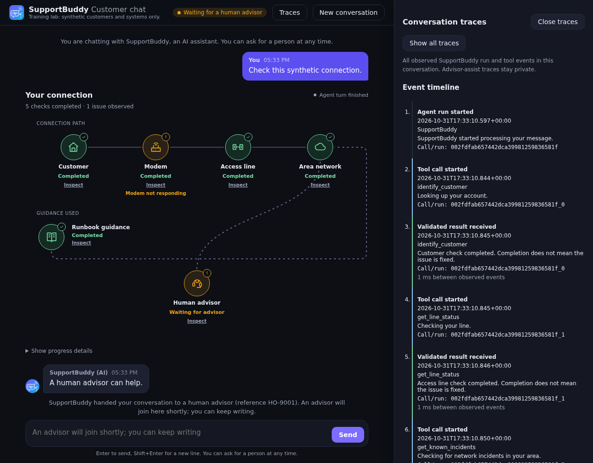
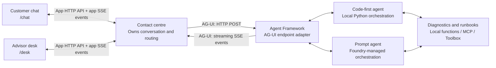
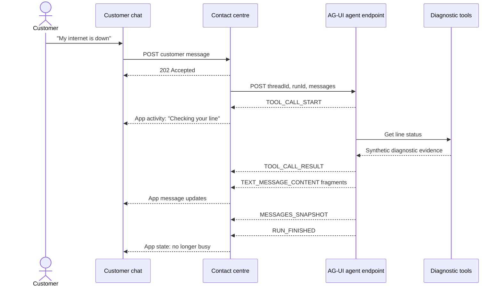
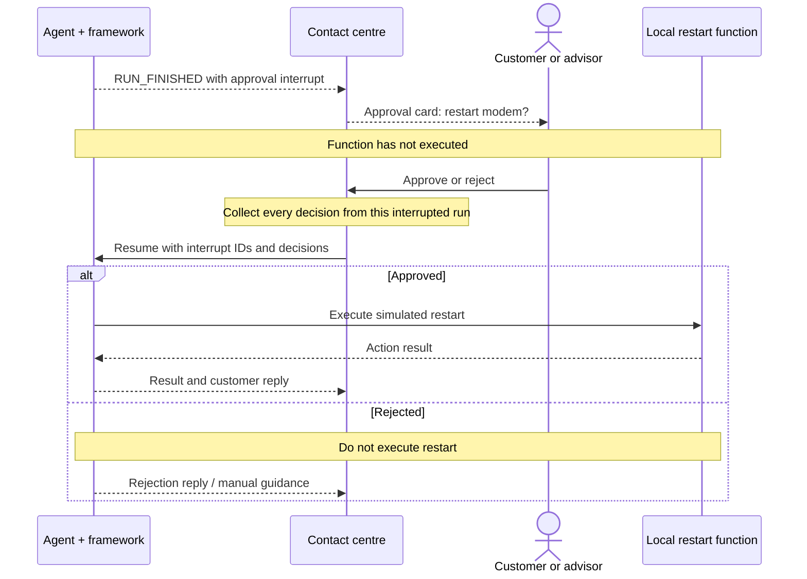
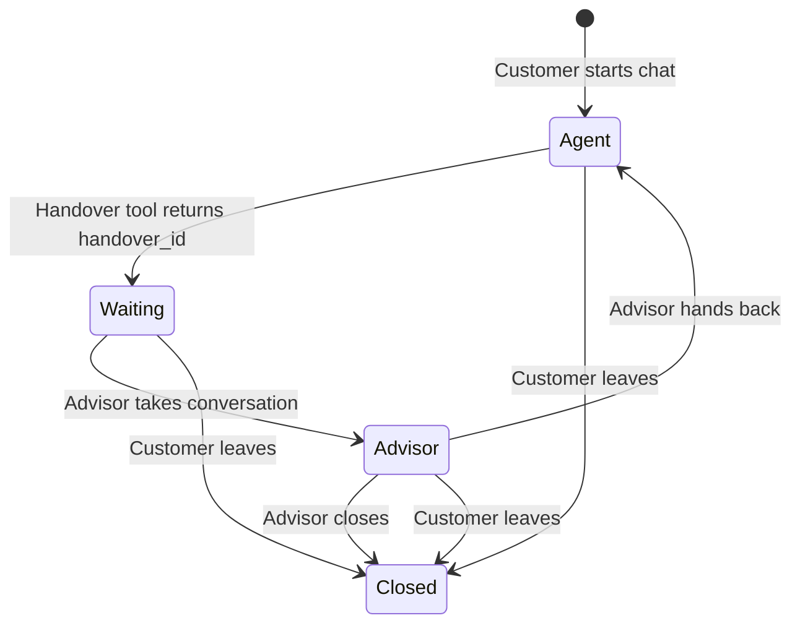
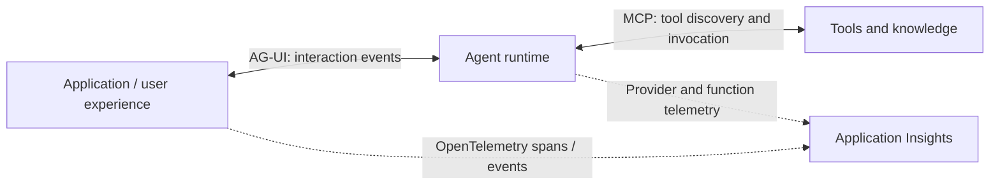

# AG-UI in SupportBuddy: from an agent run to a usable support experience

> **In one sentence:** AG-UI gives our contact centre a structured, streaming conversation with the
> agent, so it can show progress, stream answers, request human approval and react to tool results.

AG-UI means **Agent-User Interaction Protocol**. It is an event-based interface between an agent
runtime and an application. It is not a model, a tool server, or a ready-made chat screen.

This guide describes the implementation in this repository. All customers, diagnostics, handovers
and modem restarts are synthetic lab constructs.

Want to build on it? Try the [optional live evidence-panel lab](./optional-ag-ui-lab.md) once the Stage 9
Azure toolbox is ready. Its `ag_ui_lab` baseline has independent instructions and a working
`--evidence-panel` solution; it does not require changing your current numbered stage.
The optional logical connection topology first appears inline when a tool starts or requests approval,
then reveals customer/modem/line/network nodes and a runbook-guidance branch as their tools
start. Active tools are named and pulse; results update the same nodes.
New connections draw into place, with flowing dashes while their endpoints are active.
Non-diagnostic and future tools appear automatically as dashed support branches, with neutral
**Result received** status until a safe result projector exists.
The human-advisor node distinguishes preparation, waiting, actual advisor arrival, hand-back and closure.
An incremental plain-language progress log explains these observed events in chat, without hidden
reasoning, raw payloads or internal processing-step names. Reduced-motion preferences disable animation.
The topology is transparent and borderless, embedded directly in chat. Clicking a node opens a live
right-hand trace drawer with its icon, safe evidence and timestamped tool-event timeline.
**Traces** / **Show all traces** displays the selected conversation's observed run and tool events
across turns, excluding private assist traffic and raw payloads. There is no initial dashboard,
no expanded detail text under the topology, and no extra model call.
It is not a discovered network map or a fixed dashboard.
It follows the [activity-widget pattern](https://docs.ag-ui.com/spec/1.0/events/activity)
using existing tool events; the adapter does not emit native activity snapshot/delta events.
The default UI is unchanged.

The optional UX follows [AG-UI's event lifecycle](https://docs.ag-ui.com/concepts/events) and
[interrupt semantics](https://docs.ag-ui.com/concepts/interrupts),
[Microsoft HAX's human-centered interaction guidance](https://www.microsoft.com/en-us/haxtoolkit/ai-guidelines/),
and [WCAG's animation guidance](https://www.w3.org/WAI/WCAG22/Understanding/animation-from-interactions.html):
show real observed activity, make uncertainty and ownership explicit, preserve human decisions,
and keep the experience usable without motion.

## Current SupportBuddy UI

The optional topology keeps its progress details collapsed by default, with smooth traces,
status badges and a compact guidance row. The real side drawer shows the observed event timeline
alongside the chat and answer:



Captured from the application's offline Chromium tests using synthetic scripted events; this
is not a live-provider timing capture. See the [optional lab screenshots](./optional-ag-ui-lab.md#current-ui-screenshots)
for collapsed and expanded progress views. The regular workshop UI is unchanged without the switch.

## Official AG-UI visuals

The following images are embedded from the official AG-UI documentation, not redrawn or stored in
this repository. Credit: the AG-UI documentation and its contributors. They illustrate the broader
ecosystem; the SupportBuddy-specific diagrams below show the smaller set we actually implement.
An internet connection is required to load these images.

### Official overview


Source: [AG-UI Overview](https://docs.ag-ui.com/introduction).
For this lab, read the application side as our contact centre and the agent side as the Agent Framework
adapter around either our code-first agent or the Foundry prompt-agent client.

### Official protocol stack


Source: [MCP, A2A, and AG-UI](https://docs.ag-ui.com/agentic-protocols).
SupportBuddy uses AG-UI for application-to-agent interaction and MCP for tools. This contact-centre
implementation does not use A2A; having a separate advisor assist agent does not itself imply A2A.

## 1. Where it fits



**Important distinction:** our browser pages do not consume AG-UI directly. The Python contact centre
is the AG-UI client. It translates agent events into the customer and advisor views.

There are **two streaming connections**:

| Connection | What travels over it |
| --- | --- |
| Contact centre to `/ag-ui/...` | AG-UI events: text fragments, tool activity, history snapshots and run outcomes |
| Browser to `/api/.../events` | Our application events: messages, conversation state, desk updates and approved actions |

Both use **Server-Sent Events (SSE)**: the server sends updates over an HTTP response as they happen.
Using SSE on both connections does not make the browser's application events AG-UI events.

## 2. What happens when a customer sends a message



The customer sees useful progress instead of a spinner until the final answer. The advisor can follow
the same conversation in the desk.

### Events we actually use

| AG-UI event | How SupportBuddy uses it |
| --- | --- |
| `TEXT_MESSAGE_CONTENT` | Append text fragments to the corresponding agent message |
| `TOOL_CALL_START` | Show a friendly activity label, such as "Testing your modem" |
| `TOOL_CALL_RESULT` | Recognize customer identification and confirmed handover results |
| `MESSAGES_SNAPSHOT` | Update the application's agent-message history |
| `RUN_FINISHED` | Read pending approval interrupts, if present |
| `RUN_ERROR` | Show that the turn failed rather than treating it as a successful answer |
| `STEP_STARTED` / `STEP_FINISHED` | Optional mode records generic processing-step activity without exposing internal step names |

These are observable execution events, **not the model's hidden reasoning**. A tool-start event also
does not prove an action succeeded; a result must confirm the outcome.

## 3. Human approval is a round trip, not a sentence in the prompt

For an approval-gated action such as a simulated modem restart, the framework pauses before executing
the local function. Our application renders an approval card and later resumes the interrupted run.



The customer approves actions requested by SupportBuddy. The advisor approves actions requested by
their private assist agent. If one run requests multiple approvals, the application waits for all
decisions and submits them together.

**Why it matters:** "Please ask permission" in a prompt is not an execution gate. The framework's
approval mechanism prevents the gated local function from running until an approval is supplied.
AG-UI carries the interruption and decision; our application decides how to present them.

This is not a guarantee of authorization or exactly-once execution. Production systems still need
authenticated decision makers, backend authorization, idempotency and audit records. If an action
executes but the following model reply fails, do not blindly repeat the action.

## 4. A handover changes who answers



The agent does not transfer a conversation merely by saying "I am handing you over."

1. The handover tool must return a real **lab handover ID**.
2. The contact centre recognizes that `TOOL_CALL_RESULT`.
3. The application changes the conversation to **waiting**.
4. An advisor takes the conversation and replies directly to the customer.

The advisor's **assist agent has a separate thread and history**. Its suggestions are visible on the
desk, not sent automatically to the customer. Human-to-human chat is application traffic; it does not
need an agent run for each message.

AG-UI exposes the evidence the application reacts to. The contact centre implements the queue,
ownership rules, handback and customer visibility; those are not automatic AG-UI features.

## 5. Same UI contract, different orchestration

| Mode | Who orchestrates the agent? | How the contact centre connects |
| --- | --- | --- |
| Code-first stages | Agent Framework in the local Python process | AG-UI adapter around the stage agent |
| Stage 10 prompt agent | Foundry Agent Service, with declared local functions dispatched by the client when used | AG-UI adapter around `FoundryAgent` |
| Advisor assist | Local code-first Agent Framework agent | Separate AG-UI assist endpoint and thread |

This lets us compare code-first and prompt-agent behavior without rebuilding the chat and desk.
The common interface does **not** make their tool execution, persistence or model behavior identical.
The Stage 14 hosted-agent deployment is a separate hosting workflow; this guide's diagrams describe
the local contact centre, not a direct AG-UI connection to that hosted deployment.

### Why prompt-agent continuation stays on the server

Foundry prompt-agent endpoints retain a native Foundry conversation and private, route-scoped AG-UI
snapshot state. On approval resume or a later turn, the adapter continues that conversation rather
than sending the entire displayed history back as fresh model input.

That distinction preserves remote MCP call identity and provider continuation metadata. Replaying a
remote call such as `network.identify_customer` as an ordinary local function call can cause an
HTTP 400 because local function names cannot contain dots. The fix is correct continuation, **not
renaming the tools or removing diagnostic evidence**.

The display history is for the interface; it is not a substitute for provider-native continuation.
Private continuation metadata is kept out of the replayed UI snapshot.

## 6. AG-UI, MCP and tracing solve different problems



| Technology | Question it answers | Example here |
| --- | --- | --- |
| **AG-UI** | How does the application interact with a running agent? | Stream an answer; show a pending approval |
| **MCP / Foundry Toolbox** | How does the agent access capabilities? | Call network diagnostics or retrieve runbooks |
| **OpenTelemetry / Application Insights** | What happened, where and how long did it take? | Correlate a turn, provider request and approval continuation |

AG-UI does not replace MCP, and showing tool activity in the UI does not replace tracing.
Telemetry content capture is separately controlled and should use synthetic data only in this lab.

## 7. The practical benefits

| Without a structured agent/UI interface | With AG-UI in this application |
| --- | --- |
| Wait for one final text response | Stream text and show live diagnostic progress |
| Parse prose to guess what the agent did | React to named tool calls and structured results |
| Build a custom pause/resume convention | Use framework interrupts and explicit approval resumes |
| Rewrite UI integration when switching runtimes | Keep one contact-centre contract for code-first and prompt agents |
| Mix advisor suggestions with customer replies | Keep customer and assist threads separate |
| Treat "I escalated" as proof | Change routing only after a handover result contains an ID |

**The main benefit is not prettier streaming. It is making agent execution usable and controllable
inside a real application workflow.**

## 8. Lab boundaries and production requirements

- The contact centre binds to loopback and has no real sign-in. Customer selection in the lab is not
  authentication. Keep forwarded Codespaces ports private.
- Browser filtering, route-scoped snapshots and conversation IDs are not production access control.
  Production scopes must come from authenticated tenant/user context.
- Conversation state and private AG-UI continuation snapshots are memory-only. After restarting the
  app, start a new conversation. Production needs durable storage and recovery rules.
- AG-UI does not guarantee that the model follows instructions, that every backend succeeds, or that a
  retry is safe. Validate results and enforce business rules in the application and tools.
- A confirmed handover here creates a synthetic record, not a real service ticket or dispatch.

## 9. Try it and find the implementation

From the repository's `src` folder, run **one** of these:

```bash
# Code-first reference with the contact-centre tools
uv run python -m contact_centre solutions.stage_7_answer_or_handoff

# Or: connect to your already-published Stage 10 prompt agent
uv run python -m contact_centre --prompt-agent
```

Open the printed **Customer chat** and **Operator desk** links. With a suitable stage or prompt-agent
definition, try a modem problem, watch diagnostic progress, and inspect an approval or a handover.
The prompt-agent definition must declare the optional local functions to demonstrate approval and
live handover.

For the optional topology exercise independent of your current stage, use:

```bash
uv run python -m contact_centre ag_ui_lab --evidence-panel
```

This selects dedicated instructions with the live Stage 9 reference tools. It does not read your
working stage or change the toolbox, published prompt agent or hosted deployment.

| File | Responsibility |
| --- | --- |
| [server.py](../src/contact_centre/server.py) | Register AG-UI endpoints, prompt-agent snapshots, browser APIs and browser SSE streams |
| [centre.py](../src/contact_centre/centre.py) | Send AG-UI requests, consume events, collect approvals and route conversations |
| [conversations.py](../src/contact_centre/conversations.py) | Conversation state, separate customer/assist views and application event bus |
| [assist.py](../src/contact_centre/assist.py) | Advisor's private code-first assist agent |
| [ag_ui_lab.py](../src/ag_ui_lab.py) | Independent optional-lab baseline with its own instructions and live reference tools |
| [prompt_agent.py](../src/prompt_agent.py) | Connect the published Foundry prompt agent and local function implementations |
| [support_tools.py](../src/tools/support_tools.py) | Local tool implementations, including the approval-gated restart |
| [test_prompt_agent_continuation.py](../tests/test_prompt_agent_continuation.py) | Real-adapter regressions for approval, rejection, follow-up and session isolation |

Further reading: [AG-UI documentation](https://docs.ag-ui.com/),
[participant workshop](./workshop.md), and [instructor setup](../instructor/setup.md).

The diagrams use Mermaid. Preview this file in a Markdown renderer with Mermaid support, such as
GitHub; plain-text viewers still show the diagram source and explanatory tables.
