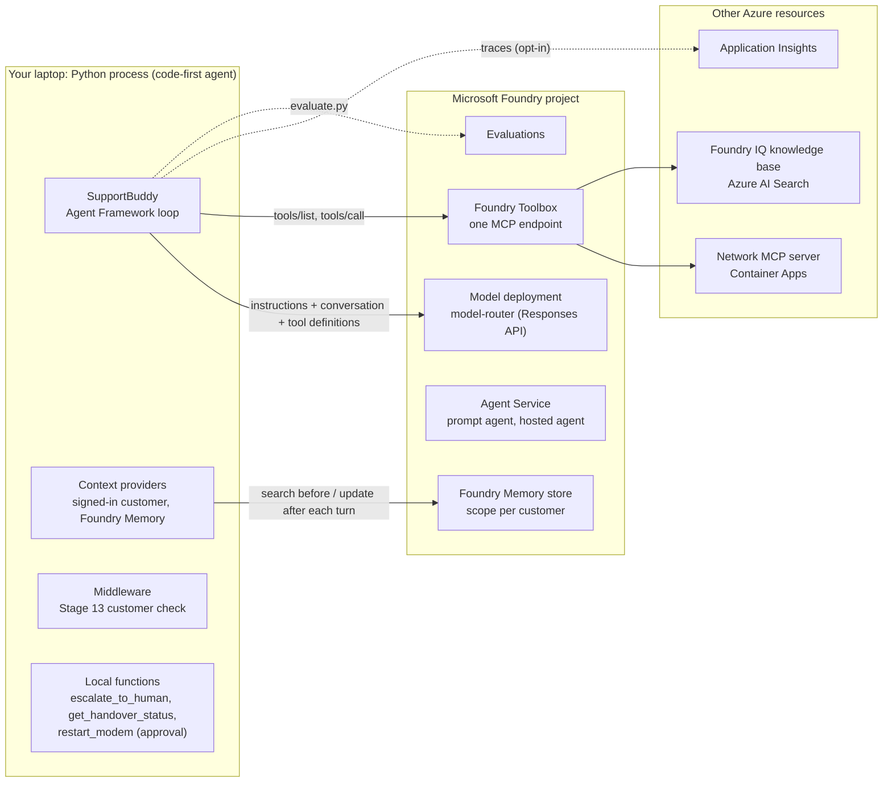
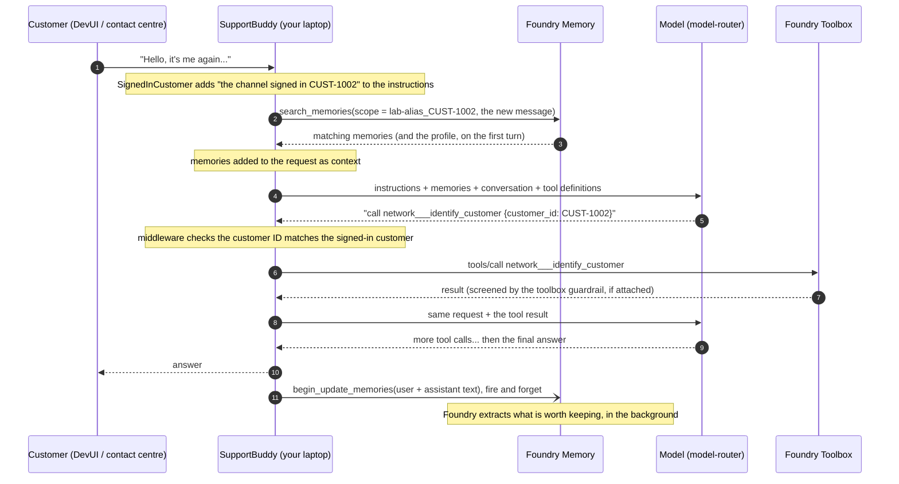

# How the code talks to Azure

A reference page for the curious: what runs on your laptop, what runs in Azure, and what travels
between them at each stage. Nothing here is a lab step; you can read it at any point.

All of it describes the code in this repository (`src/`), with the pinned Agent Framework version.

## The big picture

Three rules explain most of it:

1. **Your code runs the loop; Foundry provides the model.** In every code-first stage, Agent Framework on
   your laptop decides what to send to the model, runs the tools and builds the answer.
   Only the model call (and, from Stage 8, the remote tools and memory) goes to Azure.
2. **Every call to Azure uses your identity.** `AzureCliCredential` turns your `az login` into a Microsoft
   Entra token for each service. No keys are stored in `src/.env`, which holds endpoints and names only.
3. **The model only sees what the code sends it.** It has no direct access to tools, memory or data:
   the code adds them to each request, and executes whatever the model asks for.

## One turn, step by step

What happens when a signed-in customer sends a message to the Stage 13 agent (the fullest code-first
version). Earlier stages simply skip the parts they do not have yet.

## Model calls (all stages)

| | |
| --- | --- |
| Code | `lab_agent.build_agent()` creates a `FoundryChatClient` |
| Where it goes | Your project endpoint (`AZURE_AI_PROJECT_ENDPOINT`), Responses API, deployment `AZURE_AI_MODEL_DEPLOYMENT_NAME` (normally `model-router`) |
| What is sent, every call | The instructions (with the synthetic scenario time), the conversation so far, the tool definitions, and any context added by providers |
| What comes back | Text, or a request to call a tool with arguments. The model never runs a tool itself |
| Identity | Your `az login`; you need the **Foundry User** role on the project |

## Tools: where each one runs

| Stage | Tool | Runs where | How the code reaches it |
| --- | --- | --- | --- |
| 2-5 | `identify_customer`, `get_line_status`, `check_equipment`, `get_known_incidents` | In your Python process | Direct function call; the docstring and type hints become the tool definition |
| 6 | The same four | Local MCP server (`localhost:8000`) | `MCPStreamableHTTPTool` connects at start-up, lists the tools, then calls them over HTTP |
| 7+ | `escalate_to_human`, `get_handover_status`, `restart_modem` | Always in your process (part of the agent's own code) | Direct call. `restart_modem` is marked `approval_mode="always_require"`, so Agent Framework stops and asks a person first |
| 8 | `knowledge_base_retrieve` | Foundry IQ knowledge base in Azure AI Search | MCP over HTTPS, with an Entra token for `https://search.azure.com`. You need **Search Index Data Reader** |
| 9+ | Network tools and runbooks | Behind your Foundry Toolbox | `FoundryToolbox` connects to one endpoint with a token for `https://ai.azure.com`. The toolbox calls the network MCP server and the knowledge base with the credentials in **project connections**, not yours |

The agent loads the tool list **once, when it starts** (`tools/list`), and keeps it. After you change a tool
or create a new toolbox version, restart DevUI or the contact centre.

## Memory (Stage 11)

Memory has two parts: a **store** in your Foundry project, and a **context provider** in your code that talks
to it around every turn.

**The store (created once):** `memory_store.py create` creates `supportbuddy-memory` in the project. It names
a chat model (to extract memories) and an embedding model (to search them), and holds the rule for what is
worth keeping: language, contact preference and short summaries of past problems; never names, addresses,
phone numbers or other personal data. You can inspect it with `memory_store.py show CUST-1002` and empty it
with `memory_store.py forget CUST-1002`.

**The provider (in your code):** `solutions/stage_11_memory.py` adds a `FoundryMemoryProvider` to the agent.
Agent Framework calls it before and after each turn:

| When | Call to Foundry | What is sent | What happens |
| --- | --- | --- | --- |
| First turn of a conversation | `search_memories` (no query) | The scope | Returns the customer's **profile** memories (for example "prefers SMS") |
| Before every turn | `search_memories` | The scope and the customer's **new message** | Returns the memories relevant to that message. The code adds them to the request, under "## Memories" |
| After every turn | `begin_update_memories` | The scope, the customer's message and SupportBuddy's answer (text only, no tool results) | Returns at once; Foundry extracts and stores what is worth keeping **in the background**. That is why `show` needs about a minute |

**The scope is the security boundary.** It is `<your prefix>_<customer ID>`, for example `lab-jml_CUST-1002`,
and it comes from the **signed-in channel** (`--customer` or the contact-centre picker), never from what the
customer types. A customer cannot reach another customer's memories by naming them in the chat.

**Lab settings to know:** `update_delay=0` writes after every turn so you can see results quickly; production
would batch updates. Memory errors are logged and ignored, so the agent still answers if Memory is down.

## Guardrails (Stage 13)

Three layers, in three places:

| Layer | Where it runs | What it does |
| --- | --- | --- |
| Model guardrail | Foundry, on the model deployment | Screens what goes to and comes from the model |
| Toolbox guardrail | Foundry, on your toolbox version (`toolbox.py create --guardrail ...`) | Screens tool inputs and outputs, for example the poisoned Wi-Fi name of `CUST-1006` |
| Customer-check middleware | Your process (`SignedInCustomerOnly`) | Before a tool runs, refuses any call about a customer other than the signed-in one. Code, not a model judgement |

## Tracing (opt-in)

With `SUPPORTBUDDY_TRACING=true` in `src/.env`, `lab_telemetry.py` asks the project for its Application
Insights connection string (nothing is stored locally) and exports OpenTelemetry spans: the agent run,
each model call and each tool call. Message content is only included with `SUPPORTBUDDY_TRACE_CONTENT=true`.
Local runs appear in Application Insights; they are not the same as the agent traces Foundry records for
prompt and hosted agents.

## Evaluation (Stage 12)

`evaluate.py` runs your agent on the dataset in `src/evals/dataset.jsonl`, on your laptop. Local checks
(`LocalEvaluator`) are Python rules and never leave your machine. With `--foundry`, the responses and tool
calls are sent to Foundry evaluators, which use a **judge model** (`AZURE_AI_EVALUATION_MODEL_DEPLOYMENT_NAME`)
to score them; the report link opens the results in the portal.

## What changes for the prompt agent and the hosted agent

| | Code-first (Stages 1-9, 11-13) | Prompt agent (Stage 10) | Hosted agent (Stage 14) |
| --- | --- | --- | --- |
| Who runs the loop | Your process | Foundry Agent Service | Your code, in a Foundry-managed container |
| Who fetches the tools | Your process, at start-up | Foundry, from the toolbox referenced in the definition | Your code, at container start-up |
| Who calls the toolbox | Your process, as you | Foundry, as the agent's identity | Your code, as the agent's identity (`DefaultAzureCredential`) |
| Local functions | Run in your process | Foundry pauses and asks your client app to run them (`--with-functions`) | Run in the container |
| What your laptop sends | Everything above | Only the customer's message | Only the request (`azd ai agent invoke`), or nothing (portal playground) |
| Memory and middleware | Stages 11 and 13 | Not in this lab | Not in this example |

## What leaves your laptop, in short

| Data | Goes to | When |
| --- | --- | --- |
| Instructions, conversation, tool definitions, tool results | Model deployment | Every model call |
| Tool name and arguments | Toolbox / MCP server / knowledge base | Every remote tool call |
| The customer's message; then message and answer text | Foundry Memory | Before and after every turn (Stage 11) |
| Spans (content only if enabled) | Application Insights | With tracing on |
| Dataset queries, responses, tool calls | Foundry evaluators | `evaluate.py --foundry` |

All data in this lab is synthetic. In a real deployment, each row of this table is a question for your
data-protection review.
