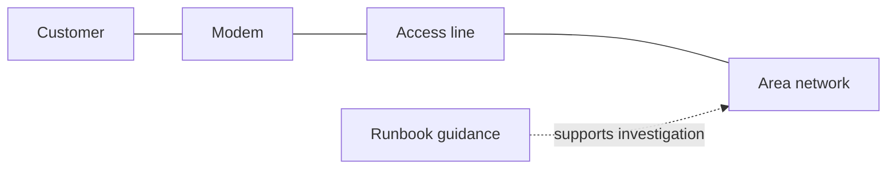
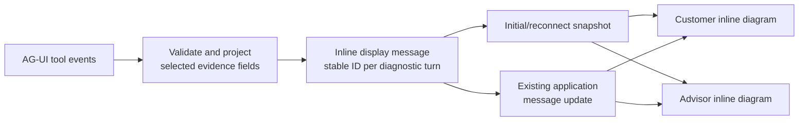
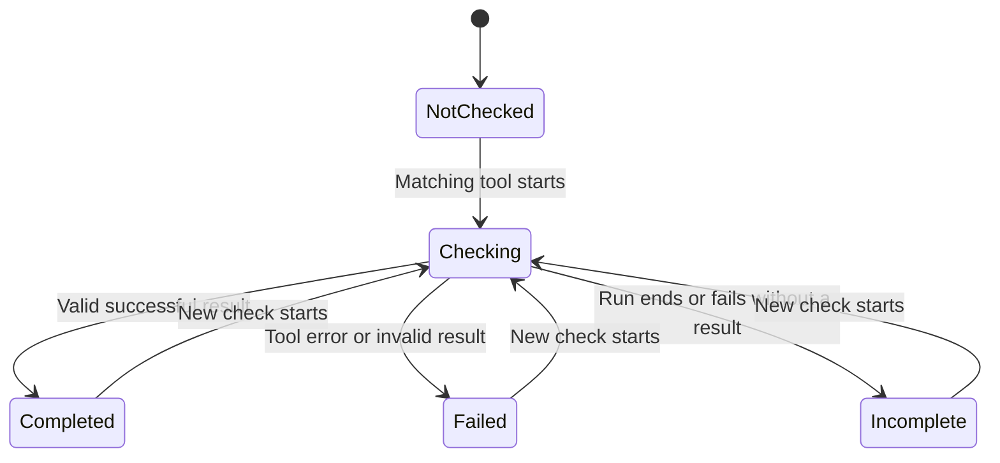

# Optional lab: watch the diagnosis happen

**Stream an inline connection topology from AG-UI events, without changing SupportBuddy's job.**

| | |
| --- | --- |
| Placement | Optional extension after Stage 9; also compatible with the Stage 10 prompt agent |
| Duration | About 30-45 minutes; allow more time for the test challenges |
| Prerequisites | Working customer chat and operator desk; completed diagnostics and runbook retrieval |
| Azure changes | None |
| Agent changes | None: keep the tools, instructions, routing model and approval rules |
| Deliverable | An opt-in, progressively revealed connection topology shared by customer chat and advisor desk |

This lab includes a **working reference solution**, disabled by default. You can run it immediately,
then use the steps below as an implementation walkthrough or rebuild the feature as an exercise.
The [AG-UI visual guide](./ag-ui.md) explains the architecture first.

## What is new, and what stays unchanged

**The checkmarked activity messages are not new.** Lines such as "Looking up your account",
"Checking your line" and "Testing your modem" already belong to the regular workshop experience.
Without the optional switch, they remain unchanged. With the switch, observed tool activity uses
the inline diagram and a customer-friendly progress log instead.

The new feature is a **seamless connection topology inside the streamed conversation**, also shown in the
selected conversation on the operator desk. It first appears when a tool starts or requests approval,
then grows node by node as real events arrive. Click a node to inspect returned evidence, for example
"Sync up; download 0/1000 Mbps", rather than just announcing that a tool is running.

| What you see | Regular lab: no switch | Optional lab: `--evidence-panel` |
| --- | --- | --- |
| Existing checkmarked activity messages | Unchanged | Tool activity becomes the inline diagram and plain-language progress log |
| Streamed answers, runbook citations, approvals and handover | Unchanged | Unchanged |
| Inline connection topology with check statuses | Absent | Created at the first tool start or approval request; nodes revealed from actual events |
| Tools, model requests and agent instructions | Existing behavior | Same behavior; no extra diagnostic or model calls |

Seeing only the checkmarked activity messages means you are looking at the regular experience,
not the optional panel. **Do not enable the switch for the numbered stages unless you deliberately
want this extension.** It is a startup option for the whole contact-centre process, not a prompt,
toolbox setting or per-message instruction.

## Run the reference solution

From `src`, choose one command:

```bash
# Stage 9 reference: no changes to your participant exercise files
uv run python -m contact_centre solutions.stage_9_toolbox --evidence-panel

# Or your existing Stage 10 published prompt agent
uv run python -m contact_centre --prompt-agent --evidence-panel
```

Open the printed **Customer chat** and **Operator desk** links. If another contact centre is already
running, stop it first or use `CONTACT_CENTRE_PORT=8071` before the command to run on a different port.
When changing the switch, restart the process, refresh the browser, and start a **New conversation**.
Send: **"I'm CUST-1002. Nothing loads on any device."**

There is **no fixed dashboard or initial waiting card**. While connections open and the agent works,
only the existing chat typing indicator appears. The topology is inserted into the transcript at the
first tool event, after any text the agent has already streamed. An approval request can also reveal
an action node before execution; it says **Awaiting approval**, not **Checking**.
The nodes and connecting paths have **no enclosing card background or border**; they are embedded
directly in the chat flow. A separate **Traces** button opens a right-hand inspector drawer.
Each matching tool start reveals its node in **Checking**, and the badge names the **Tool running**.
Its valid result changes the node to **Completed**; an invalid/error result shows **Failed**.
A check still awaiting a result when the run ends becomes **Incomplete**.
A completed check can report a problem. The card updates on the desk too and survives
a browser reload without rerunning the tools. Without `--evidence-panel`, the existing UI and agent
requests remain unchanged. A later agent turn gets its own card; earlier cards retain their original
findings. Approval continuation updates the same card rather than creating another one.
No new Azure resources, prompt-agent publication or toolbox version is needed.

### What you should see, event by event

The topology is revealed by **tool activity**, not by a timer or by parsing the final answer.
These are illustrative steps; the agent chooses which tools to call and in what order.

| Agent progress | Visible UI |
| --- | --- |
| You send a message; the agent starts | The existing typing indicator appears. No topology or empty card yet. |
| Customer lookup starts | The house icon appears with **Checking** and **Tool running: Customer**. |
| Customer lookup returns | The same node shows **Completed**; its inspector contains the safe finding. |
| Modem check starts | The modem icon appears and pulses; the badge says **Tool running: Modem**. A customer-to-modem link appears if both nodes are present. |
| Line or incident check starts | Only the corresponding **Access line** or **Area network** node appears. Its check is active; unrequested nodes remain absent. |
| Several checks run together | Multiple nodes pulse and the badge lists them, for example **Tools running: Modem, Access line**. |
| Runbook retrieval starts | The book icon appears with **Tool running: Runbook guidance**. A dashed guidance branch appears when a connection-path node is available. |
| Runbook retrieval returns documents and source references | The book node shows **Completed**; its inspector shows a validated document count, without revealing document text or source URLs. |
| A new tool without a display definition starts | An **Additional tool** node appears automatically on a dashed support branch; each unrecognized call has its own node and inspector. |
| A tool without a result projector returns | Its node says **Result received**, not successful, healthy or fixed. Raw results stay out of the display. |
| Handover starts | A headset **Human advisor** node appears, with a preparation log and an animated support branch. |
| A handover result is confirmed | The node says **Waiting for advisor**. A created handover record does not mean an advisor has joined. |
| An advisor takes the conversation | The node changes to green **Advisor joined**, and a customer-facing log records the ownership change. |
| The advisor hands back or closes the chat | The same node and timeline update to **Back with SupportBuddy** or **Chat closed**. |
| The run finishes or requests approval | Findings remain visible; the badge changes to **Agent turn finished** or **Waiting for your decision**. Approval uses the existing chat card. |

**A completed check is not necessarily a healthy connection.** A returned modem fault, loss of sync
or open incident can turn a node amber and show **Issue observed** while its tool status remains
**Completed**. A turn with neither tool activity nor an approval request creates no topology.

If all requested elements appear together, the provider may have delivered their events in one burst.
The application preserves distinct start/result updates, but cannot guarantee a visible pause between
them. It does not slow down the tools or replay their execution with fabricated timing.

### Interact with the evidence and advisor workflow

The same `--evidence-panel` switch enables three controlled-UI improvements inspired by the
[Dojo](https://dojo.ag-ui.com/?integration=ms-agent-python&demo=beautiful-chat):

1. **Open the trace drawer.** Click a node's icon or label, or focus it with **Tab** and press **Enter**
   or **Space**. A right-hand side panel shows that node's visual icon and semantic status colors, validated
   resource IDs, tool status and findings. Details do not expand beneath the topology or add chat messages.
   The drawer stays open and updates when the node receives a result. It also shows an **Event timeline**:
   starts, completed/error results and checks left incomplete, correlated by tool-call ID.
   Timestamps are local event-receipt times; displayed intervals are not provider execution durations.
   Select **Traces** in the chat header or desk toolbar, or **Show all traces** inside the drawer,
   to see all observed SupportBuddy run and tool events across the selected conversation's turns:
   run starts/outcomes, approval-required outcomes, diagnostic results, and other tools such as handover
   or restart. Results from tools without an evidence projector are labelled **not projected**,
   not silently classified as healthy. Replayed lifecycle events are deduplicated.
   This is a DevUI-style interaction inspector, not the full DevUI or Application Insights trace viewer.
   It excludes raw payloads, prompts, hidden reasoning and the advisor's private assist events.
   **Escape** or **Close traces** dismisses it and restores focus. On wide screens the chat makes room
   for the drawer; on narrow screens it overlays the chat with its own scroll and close control.
   There is no modal backdrop or focus trap; the desktop chat remains interactive beside the drawer.
   No extra diagnostic runs or model calls are made. Customer identity details remain limited
   to identified/not identified; runbooks expose a document count, not raw documents or source URLs.
   Node buttons stay transparent even on hover. Clicking briefly pulses the icon in its existing
   status color; keyboard focus uses an outline around the icon rather than a filled tile.
   Reduced-motion preferences disable the click pulse.
2. **Review a restart approval.** The optional approval card includes the expected connection
   interruption and any observed modem evidence, labelled with its evidence status.
   The original pending tool arguments remain visible and define the requested target;
   evidence is context, not authorization or proof that a restart is appropriate.
   If no modem evidence is available, the card says so. **Approve** and **Decline** still use the
   original interrupt/continuation flow; opening the inspector never executes an action.
3. **Use an advisor reply draft.** Take the conversation on the desk, then select **Suggest a reply**.
   Once that assist run finishes successfully, **Use suggested reply** copies its response into the
   customer-message composer. Review/edit it and press **Send** yourself.
   It never sends automatically, refuses to overwrite an existing composer draft, and rejects drafts
   exceeding the message limit. The button is disabled unless the conversation is in advisor mode
   and assist is idle. Suggestions stay in the advisor's private transcript until explicitly sent.

The regular desk already supports **Use as reply** when an assist response includes
`Suggested reply:`. The optional mode uses application metadata for the explicit suggestion request,
so it does not depend on the model writing that heading or expose a half-streamed reply as ready.
Without the switch, the normal lab's rendering and approval flow remain unchanged.

The map uses **house, modem, access-line, network and book icons**, not five numbered checklist boxes.
Customer, modem, access line and area network form a logical connection path; runbooks sit on a
separate dashed guidance branch. Narrow screens use a two-column, folded topology with redrawn links.
Running nodes pulse and their connecting paths animate; completed nodes retain their status and
their inspector retains the findings.
New connections draw into place once; running connections then use a subtle flowing dash.
Dashed support branches can contain restart, case-status, human-handover and future tool nodes,
without changing the physical-path layout or inventing physical links.
Connections appear only after both endpoint nodes have been observed. Unrequested checks stay absent,
and gaps are not bridged with invented physical links. The diagram's spatial arrangement is the logical
support path, while node arrival order follows the actual tools. The badge lists all active tools if
checks run in parallel.
Amber nodes mark returned issues such as loss of sync, an unreachable modem or an open incident,
while the check itself still says **Completed**.
Status colors use familiar conventions, with text labels retained for accessibility:

| Color | Meaning |
| --- | --- |
| Blue | A tool is running; its node pulses and active links animate. |
| Green | A check completed successfully with no explicitly flagged issue in its projected evidence. This does not prove the connection is fixed. |
| Amber | An issue was observed, a check ended without a result, or an approval decision is pending. |
| Red | A tool check failed or the agent run failed. |
| Gray | Neutral state, previous evidence or finished-run information. |

A completed check that finds a fault has an **amber node**, a green **Completed** tool-status label
and an **Issue observed** label. Blue takes priority while that node is being checked again;
an actual failed check is red, not amber. Links do not turn green merely because tools completed:
they represent schematic relationships, not verified network connectivity.
Several checks can be active together: connections are relationships, not an execution order.
This is a **schematic support topology, not a discovered network map or proof of healthy links**.
A separate live badge shows **investigating**, **waiting for a decision**, **finished** or **failed**,
using the actual run outcome and approval interrupts. Reduced-motion preferences disable animations.

### Customer-facing logs and interaction principles

The borderless topology includes a **Progress updates** log in chat, mirrored on the desk.
It records friendly tool starts, validated diagnostic completions, unprojected results, interruptions,
approval requests/decisions and human ownership transitions. If the adapter emits optional
`STEP_STARTED` / `STEP_FINISHED` events, they appear as generic processing steps; internal step names
are not exposed. The log updates incrementally in a polite live region. It follows new entries only
when its reader is near the bottom; scrolling back is respected. Reload reconstructs the log from
the same per-turn event snapshot without extra tool calls.

The design follows:

- [AG-UI events](https://docs.ag-ui.com/concepts/events): render observed lifecycle/tool/step events;
  do not treat argument streaming or tool-call end as a confirmed result.
- [AG-UI interrupts](https://docs.ag-ui.com/concepts/interrupts): show a genuine pause and explicit
  decision. Approval is not execution; only a returned result confirms that the tool returned.
- [Microsoft HAX guidelines](https://www.microsoft.com/en-us/haxtoolkit/ai-guidelines/):
  support customer understanding and control, distinguish AI from human ownership, and make
  uncertainty explicit rather than presenting completion as resolution.
- [WCAG animation guidance](https://www.w3.org/WAI/WCAG22/Understanding/animation-from-interactions.html):
  respect reduced-motion preferences, keep motion subtle, and retain readable text statuses.

These logs report observed activity, **not chain of thought**. The topology and progress log never
display raw tool arguments/results, internal step names or private advisor-assist activity.
The existing approval card still shows the requested action's target arguments for informed consent.
Event times are local
receipt times, not measured provider durations. There are no fabricated percentage-complete
indicators, simulated delays or invented intermediate steps.

**Answer streaming:** AG-UI `TEXT_MESSAGE_CONTENT` deltas are appended and published immediately,
then delivered over application SSE to both chat and desk. The browser updates the same answer
message before the run finishes; it does not wait for the final response. These are text chunks,
not necessarily one model token per event. Provider buffering can still deliver several chunks
together. Offline browser tests hold back the final chunk and verify that the first chunk is already
visible in both views, with and without the optional switch; this does not certify live provider timing.

### Adding more tools

New tool starts automatically produce safe **Additional tool** nodes and lifecycle logs, keyed by
call ID. They do not require frontend changes to become visible. To give a known tool a friendly
name/icon, add its approved label to `PROGRESS` in [centre.py](../src/contact_centre/centre.py) and its
display definition to `TOPOLOGY_TOOLS` in [common.js](../src/contact_centre/static/common.js).
Only add it to `CAPABILITIES` / `_findings` in [evidence.py](../src/contact_centre/evidence.py) when
you also implement and test a strict safe-result projector. Until then, keep its result neutral.
Never assign a new tool to the schematic physical path unless that relationship is actually part
of the lab's model.



The UI consumes AG-UI tool-start/tool-result events and run-finish/error/interrupt events already
emitted by the agent adapter. Updates arrive as those events arrive; some providers batch remote MCP
events, so very fast or buffered checks may complete together. We do not insert artificial delays,
invent intermediate results or pretend to stream hidden model reasoning. This remains an AG-UI
event projection into application display messages, not an implementation of `STATE_DELTA`.
Each published application event holds its own message snapshot, so a later mutation cannot replace
an earlier **Checking** update in the SSE queue. A zero-delay scheduling yield lets queued events
be sent without imposing a fake duration on a tool. If the provider buffers events, the chat typing
indicator remains visible until those events arrive; the topology is not created early to hide buffering.

### Relationship to the official AG-UI examples

The [official Dojo](https://dojo.ag-ui.com/) showcases controlled generative UI:
application-owned components rendered from agent activity. The
[AG-UI activity specification](https://docs.ag-ui.com/spec/1.0/events/activity) describes the relevant
UX pattern explicitly: a structured widget keeps its place in the message sequence and updates
under one message ID. CopilotKit's
[custom-chat tool-rendering example](https://docs.copilotkit.ai/reference/hooks/useRenderToolCall)
renders tool messages inside chat and distinguishes preparing, executing and completed states.
The [application quickstart](https://docs.ag-ui.com/quickstart/applications)
also shows rich output flowing through an event stream.

We follow that **inline, update-in-place pattern**, using the tool and lifecycle events our pinned
adapter already emits. The contact centre creates an application-owned `evidence` display message;
it does **not** emit native `ACTIVITY_SNAPSHOT` / `ACTIVITY_DELTA` or require a new UI framework.
Display messages never become model input or replace Foundry's private continuation history.

### Return to the regular lab

Stop the optional process with **Ctrl+C** and run the same agent without the switch:

```bash
# Regular Stage 9
uv run python -m contact_centre solutions.stage_9_toolbox

# Or regular Stage 10 prompt-agent chat
uv run python -m contact_centre --prompt-agent
```

Refresh and start a new conversation. The evidence panel is hidden; the original progress messages
and all normal workshop behavior remain.

The reference implementation is shared application plumbing rather than a new agent stage:

| File | Reference solution |
| --- | --- |
| [evidence.py](../src/contact_centre/evidence.py) | Allowlisted projections, call correlation, duplicate suppression and safe lifecycle timeline |
| [centre.py](../src/contact_centre/centre.py) | Create the inline topology at the first tool/approval event; record safe run/tool/step and human-ownership events |
| [conversations.py](../src/contact_centre/conversations.py) | Immutable queued event snapshots; display transcript for reconnect |
| [server.py](../src/contact_centre/server.py) | Opt-in CLI switch and configuration |
| [common.js](../src/contact_centre/static/common.js) | Shared safe renderer for customer and advisor |
| [test_evidence_panel.py](../tests/test_evidence_panel.py) | Offline projection, failure, isolation and behavior-preservation tests |
| [test_evidence_panel_browser.py](../tests/test_evidence_panel_browser.py) | Optional Chromium checks against a scripted local app; no Azure calls |

## Why this belongs in a connectivity-support lab

The customer should not need to understand tool names, and the advisor should not have to read an
entire transcript to learn what was checked.

The existing application already streams answers, shows tool activity and supports approval cards.
This extension adds something different: **a persistent, structured view of diagnostic evidence**,
available before the final answer and still visible after handover.

```text
Connection checks                         Evidence, not a diagnosis
-----------------------------------------------------------------
Customer          Completed    Customer identified
Line LINE-2002    Completed    Sync up; measured download 0 Mbps
Area incidents    Completed    No open incident returned
Modem             Completed    Not responding
Runbook           Completed    Retrieval completed
-----------------------------------------------------------------
Action approval remains in the existing chat card.
```

These are illustrative labels for the synthetic modem scenario, not values to hard-code.
In particular, **completed does not mean healthy**: a successful check can find a down line.

### The "wow" moment

Open chat and desk side by side. Send one customer message. Watch evidence appear in both views as
tools complete, while the answer is still being composed. Then hand over to an advisor: the evidence
stays with the conversation, with no second model call to summarize it.



This is event-driven UI built on AG-UI tool events. It does **not** implement AG-UI `STATE_DELTA` or
`STATE_SNAPSHOT`, and it is not model-generated HTML. Browser updates still use our application API.

## Ground rules

- Keep the opt-in switch `--evidence-panel` default **off**. Expose that setting
  through `/api/config` so both browser pages agree.
- Do not edit [main.py](../src/main.py), [main.instructions.md](../src/main.instructions.md), the
  reference agent instructions, toolbox definitions or backend fixtures for this extension.
- Do not add a model call, repeat diagnostics, or parse the final answer to populate cards.
- Do not display complete tool payloads, names, e-mails, phone numbers, addresses, Wi-Fi names,
  reasoning or the advisor's private assist conversation.
- Keep all existing approval and handover behavior. An evidence card is not an action button.
- Use synthetic lab data only and keep Codespaces ports private.

## Step 1: see the events before building the panel

From `src`, start your working Stage 9 reference:

```bash
uv run python -m contact_centre solutions.stage_9_toolbox
```

Or, if you have already published the Stage 10 prompt agent:

```bash
uv run python -m contact_centre --prompt-agent
```

Open the printed chat and desk links. In a new conversation, send:

> I'm CUST-1002. Nothing loads on any device.

Find these existing pieces:

| File | Read this part |
| --- | --- |
| [centre.py](../src/contact_centre/centre.py) | `_consume`: `TOOL_CALL_START`, `TOOL_CALL_RESULT` and `RUN_ERROR` handling |
| [centre.py](../src/contact_centre/centre.py) | `tool_name` and `tool_result`, which already normalize toolbox names and unwrap MCP results |
| [conversations.py](../src/contact_centre/conversations.py) | Conversation views and `publish_state` |
| [server.py](../src/contact_centre/server.py) | `/api/config`, customer event filtering and desk event snapshots |
| [chat.js](../src/contact_centre/static/chat.js) | Initial `snapshot` and subsequent `message` updates |
| [desk.js](../src/contact_centre/static/desk.js) | Desk snapshot, selected conversation and incremental updates |

**Checkpoint:** explain why the browser cannot simply subscribe to the Python client's existing
AG-UI stream. The contact centre consumes that stream and publishes separate, filtered application
events to the browser.

## Step 2: separate display evidence from agent histories

Keep the evidence on its conversation, separate from both agent-message histories.
Only the safe, projected fields enter an application display message, not the agent histories.
Keep a stable message ID while that diagnostic turn streams; preserve its snapshot on later turns.
Use one row per capability and resource: two lines must produce two line rows, not overwrite each
other. Correlate in-flight results by tool-call ID, not by event order.

An illustrative row shape:

```json
{
  "key": "line:LINE-2002",
  "capability": "get_line_status",
  "status": "completed",
  "finding": "Sync up; measured download 0 Mbps",
  "signal": "observed",
  "run_id": "the-run-that-collected-this-evidence"
}
```

Use an explicit lifecycle:



Here, "Incomplete" means **no usable result was observed**, not "the service is down".
Keep evidence status separate from its `signal`: a completed check may have `attention`
because it returned sync down, an open incident or an unreachable modem. That is not a failed tool call.
Do not silently keep a previous finding as though it came from the new check. Either replace it
with "Checking" or clearly mark the old finding as previous evidence.

**Checkpoint:** a fresh conversation has no findings. Missing evidence is never shown as healthy.

## Step 3: project only supported tool results

Extend the existing event-consumption path rather than opening another connection to the agent.
Keep the existing text, approval, identification and handover branches intact.

| Tool | Suggested safe projection |
| --- | --- |
| `identify_customer` | Identified / not found; no contact details |
| `get_line_status` | Line ID, sync, measured versus subscribed download, errors/resyncs when present |
| `get_known_incidents` | Open-incident count, or no open incident returned; do not infer resolution from the wall clock |
| `check_equipment` | Reachability and packet loss where provided; do not expose Wi-Fi network names |
| `knowledge_base_retrieve` | Count validated retrieved documents; do not expose document text or titles |

Implementation tasks:

1. On the first `TOOL_CALL_START`, create the display message at that point in the transcript.
   Record the call ID, normalized tool name, current run ID and local event receipt time;
   reveal that capability's node. Do not create a card at agent-run start.
2. Set that check to **Checking** and publish an update to the existing display-message ID.
3. On its `TOOL_CALL_RESULT`, validate the expected result shape before projecting allowlisted fields.
4. Reuse existing parsing helpers where suitable, but preserve error information: `tool_result`
   returns `None` for an MCP error envelope or unsupported payload. Treat malformed diagnostic evidence
   explicitly as failure, not as an empty successful result.
   **Knowledge retrieval has a separate raw-result parser**: its valid document list is not a diagnostic
   dictionary. Foundry can concatenate document JSON with individual `kind: reference` source JSON
   records in one text block. Validate reference IDs and source shape, count documents only once,
   and never publish their text or source URLs. Prefer structured MCP content when it is present;
   do not mistake an empty text envelope for zero documents.
5. On a failed or finished run, mark checks still waiting for a result **Incomplete**.
6. Make duplicate events idempotent. Do not duplicate rows or add another action to handle an event.
7. Record safe lifecycle events with their call IDs and receipt times. Include the selected-turn
   timeline with the display message and the conversation-wide timeline in application state.
   The drawer can update live and reconstruct from browser reconnect snapshots, even when a turn
   has no supported diagnostics. Non-diagnostic tools still render neutral trace-backed nodes;
   no tool activity or approval request means no topology.

Only project the customer-facing SupportBuddy stream in this exercise. Do not let `_consume` calls
for `assist_history` populate the customer panel. Updating evidence from advisor-only checks would
need a separate, explicit visibility policy.

**Checkpoint:** a dotted name such as `network.get_line_status` and an underscored name such as
`network___get_line_status` select the same projector. Neither changes the original protocol history.

## Step 4: send one display message to both views

Add the safe evidence projection as an `evidence` message in the application's display transcript.
Publish updates using the existing `message` event with the same ID. Reconnect snapshots already
include this transcript, so cards return in their original positions.

This avoids introducing a new browser event type that the customer stream's current filter would
drop. If you choose a new event type instead, update and test that filter deliberately.

Keep these boundaries:

- Customer event streams contain only that customer's conversation.
- Desk updates identify which conversation changed.
- Freeze each queued event's payload at publication; do not enqueue a shared mutable message.
- Selecting a different desk conversation renders only that conversation's transcript and diagrams.
- A new agent turn creates a new card; it must not overwrite an earlier turn's findings.
- Approval resume correlates by interrupt ID and updates the same diagnostic card.
- Turns without tool activity or approval requests create no topology, placeholder or extra display message.
- The assist transcript and private provider continuation metadata are not copied into evidence.
- Handover changes ownership, not the evidence already collected. Its node/log follows actual
  waiting, advisor-join, hand-back and chat-close transitions.

**Checkpoint:** reload the browser. Evidence reappears from the application snapshot without running
diagnostics again. This is browser reconnection, not persistence across a Python-process restart.

## Step 5: render a useful panel, not a payload viewer

Render the `evidence` display-message role inside the existing message lists using
[common.js](../src/contact_centre/static/common.js), shared by customer chat and desk.
Do not add a fixed section above either transcript.

- Create no evidence messages when the opt-in switch is off.
- Insert the topology at the first tool start or approval request, not when a conversation or agent turn starts.
- Before that event, retain the existing chat typing indicator only. Reveal each node at its tool-start event and name
  the active tool in the live badge. Do not pre-populate nodes for checks the agent has not requested.
- Draw actual connecting paths between node icons and a dashed guidance branch. Recompute their
  positions after updates and viewport changes, and draw a link only when both endpoints exist;
  do not present tool execution order as a network.
- Draw new links into place once, then animate active links subtly. Disable both animations
  under `prefers-reduced-motion: reduce`; links and labels must remain visible.
- Render unfamiliar tools automatically as neutral support branches, keyed by call ID.
- Append safe plain-language progress entries in chat; keep the diagnostic drawer for technical detail.
- Update its existing DOM nodes so another tool's result does not restart an active node's animation.
- Do not draw a containing box around topology nodes: keep the group transparent and borderless.
- Open a right-hand trace drawer with node evidence and a conversation-wide **Show all traces** view.
  Keep it updated while open; provide keyboard activation, Escape dismissal and focus restoration.
  Do not expand findings beneath the topology, show a modal backdrop, or send clicks to the model.
- Use `textContent` and DOM creation, following the existing rendering pattern; never insert tool
  text with `innerHTML`.
- Show a text status alongside any color or icon.
- Use a polite live region for meaningful status updates, not every streamed text fragment.
- Keep the chat composer and existing approval cards usable on small screens.
- Label the view as a **logical support topology**, not discovered infrastructure.
  "Line up" does not mean "customer issue resolved".

The reference solution's opt-in launch command is:

```bash
uv run python -m contact_centre solutions.stage_9_toolbox --evidence-panel
```

The same switch can be combined with `--prompt-agent`. The exercise does not require another stage
file because the agent itself is unchanged.

## Step 6: prove the panel adds information without changing behavior

Use fresh conversations for each scenario. Prefer scripted events for automated tests; live models
are nondeterministic and may not select every tool in every turn.

| Scenario / test | What must happen |
| --- | --- |
| Feature off | Existing UI and agent behavior remain unchanged; panel hidden |
| Before sending a message | No fixed diagram or empty dashboard |
| Agent waiting for provider/tool events | Existing typing indicator only; no topology or empty card |
| Successive tool starts | Reveal only that tool's node; pulse it and name the running tool; add links only between present endpoints |
| Open node while checking | A side drawer opens with the node icon and timeline; streamed results update it without another tool call |
| All traces | Selected conversation's observed run/tool events across turns; no raw payloads or private assist events |
| Seamless topology | Transparent, borderless group in the transcript; no card shown before the first tool/approval event |
| Future tool | Automatic distinct generic node, dashed support branch, correlated inspector and safe progress log |
| Human handover | Preparation is not advisor arrival; waiting/join/hand-back/close update the same node and log |
| Reduced motion | No draw/flow/pulse animation; connections and text statuses remain visible |
| Optional restart approval | Show service impact and status-labelled modem evidence without changing explicit approve/decline behavior |
| Requested advisor reply | Successful completion enables a private draft button; copy only, no automatic send or overwriting an existing draft |
| Buffered tool events | Distinct start/result message snapshots survive the SSE queue, even if the provider sends a burst |
| Foundry runbook sources | Document JSON followed by reference JSON displays a validated document count, not false failure |
| Follow-up diagnostic turn | New inline card; earlier findings and sequence position preserved |
| CUST-1002, no internet | Show returned line/modem evidence without asserting the issue is fixed |
| CUST-1001, area outage | Show returned outage evidence; the panel itself neither offers nor performs a restart |
| CUST-1005, no internet | Healthy-looking checks remain factual; existing inconclusive-evidence handover still works |
| Approved restart | Existing approval flow runs the synthetic action once; panel rendering adds no calls |
| Declined restart | No action executes; failed/rejected status is not shown as success |
| Missing/malformed/error result | Failed or incomplete check, never a green "healthy" default |
| Two line results out of order | Both lines remain visible and correctly matched |
| Replayed tool result | No duplicate row, model call or action |
| Advisor takeover and handback | Evidence survives; normal conversation ownership rules still apply |
| Browser reload | Evidence restores from snapshot; no repeated diagnostics |
| Two conversations | No evidence leaks across chats or selected desk cases |
| Private assist run | Its tool results never appear in the customer evidence panel |
| Tool text containing markup/instructions | Rendered as inert text or excluded by the allowlist |

Use the scripted event approach in [test_contact_centre.py](../tests/test_contact_centre.py) for
projection, isolation and reconnect tests. Keep the existing approval/continuation regressions in
[test_prompt_agent_continuation.py](../tests/test_prompt_agent_continuation.py) passing.

From `src`:

```bash
uv run pytest -c pyproject.toml ../tests/test_evidence_panel.py ../tests/test_contact_centre.py ../tests/test_prompt_agent_continuation.py -q
```

The reference also includes optional real-browser checks. To run them without adding Playwright to
the application dependencies:

```bash
uv run --with playwright python -m playwright install chromium --only-shell
# If the browser reports missing system libraries (Linux):
uv run --with playwright python -m playwright install-deps chromium
uv run --with playwright python -m pytest -c pyproject.toml ../tests/test_evidence_panel_browser.py -q
```

The browser tests use scripted events and temporary isolated synthetic state, not paid model calls.
They are skipped by the ordinary suite when Playwright is not installed.

When extending the solution, add focused tests for your projection logic and UI switch. Compare the tool-call sequence with
the feature enabled and disabled: it must be identical for the same scripted run.
Check both browser views manually; Python tests alone do not prove DOM behavior or accessibility.

## Finish with a two-minute demonstration

1. Open a new customer chat and the desk side by side.
2. Report CUST-1002's modem problem; watch evidence cards update during the run.
3. Reload one browser tab: the panel reconstructs without another diagnostic call.
4. In a separate CUST-1005 chat, demonstrate handover and the advisor seeing the collected evidence.
5. Explain: **the same tool execution powers the answer, live progress and evidence panel.**

### What you learned

AG-UI lets an application do more than print model text. Structured execution events can drive a
purposeful interface, while the application still owns presentation, privacy and human workflow.
This extension leaves the workshop's actual purpose intact: collect evidence, use runbooks, act only
with approval, and hand over when the evidence does not justify an answer.

For production, add authenticated authorization, durable state, bounded event recovery and
idempotent backends. This optional lab does not turn the loopback simulation into a production
contact centre.
