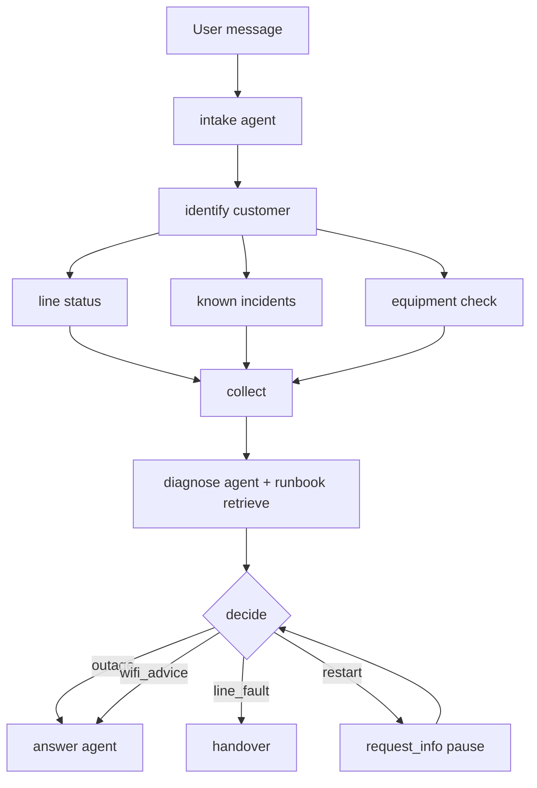

# Optional lab: explicit workflow orchestration in MAF

Build a second, **independent** optional variant of SupportBuddy that showcases explicit graph orchestration with Microsoft Agent Framework workflows.

| | |
| --- | --- |
| Placement | Optional extension after Stage 9 (independent from numbered stages) |
| Duration | About 45-60 minutes |
| Azure changes | None |
| Dependency changes | None |
| Working files touched | `src/workflow_lab.py` and dedicated workflow instruction files |

## Why this lab exists

The numbered workshop path teaches one main support agent and its enterprise integrations. This optional lab teaches a different concern: **explicit control flow** in MAF (fan-out/fan-in, typed verdicts, pause/resume approvals, deterministic routing), while still using the same synthetic domain and Stage 9 live tools.

## Design summary

The workflow has explicit executors for data collection and decisioning, plus three judgment agents:

1. `intake`: structured request extraction.
2. `diagnose`: deterministic one-pass runbook retrieval, then model synthesis.
3. `answer`: customer-facing response with runbook citation.

Deterministic executors (`identify`, `line`, `incidents`, `equipment`, `collect`, `decide`) enforce rule gates and action safety.

## MAF patterns and this lab

MAF documentation names five built-in multi-agent orchestration patterns. They describe how agents
coordinate; they are distinct from the lower-level workflow graph, executor, and edge APIs used here.

| MAF pattern | General shape | Used in this lab? |
| --- | --- | --- |
| Sequential | Participants run in a defined order, passing work forward. | **Yes, as graph stages:** intake, identify, collect, diagnose, decide, then answer when applicable. |
| Concurrent | Participants run in parallel and their results are collected. | **Partly:** the `line`, `incidents`, and `equipment` deterministic executors fan out and join. These are not three agent calls. |
| Handoff | Agents transfer control to another agent based on the conversation or task. | **No.** CUST-1004's human support handover is a deterministic backend action, not MAF's agent-to-agent Handoff pattern. |
| Group Chat | Multiple agents collaborate through a shared conversation. | **No.** Each agent has a fixed role and receives a fresh, typed input; agents do not chat with one another. |
| Magentic | A manager dynamically plans work and delegates to specialist agents. | **No.** The graph and routes are predefined; no manager agent plans or delegates tasks. |

### What this workflow combines

This example mixes model judgment with deterministic control. The graph decides **when** each step runs;
agents interpret or phrase information at three bounded points:

| Step | Kind | Responsibility |
| --- | --- | --- |
| `intake` | Agent | Extract explicit identifiers, symptom, language, and scope as structured data. |
| `identify` | Deterministic executor | Validate intake and customer identity; stop before diagnostics if input is invalid, missing, or out of scope. |
| `line`, `incidents`, `equipment` | Deterministic executors, concurrent | Read synthetic evidence in parallel. |
| `collect` | Deterministic executor | Merge evidence into one case for diagnosis. |
| `diagnose` | Mixed | Its executor retrieves runbooks once; its agent returns a typed verdict. |
| `decide` | Deterministic executor | Check the verdict against evidence and runbook IDs, then send the case to `answer`, request approval, or perform a human handover. |
| `answer` | Agent | Produce the cited customer response only after the deterministic route selects it. |

The restart branch uses MAF's `request_info` pause/resume capability for human approval. That is a
workflow interaction capability, not a fourth agent or a separate agent orchestration pattern. See the
[MAF workflow orchestration catalog](https://learn.microsoft.com/en-us/agent-framework/workflows/orchestrations/)
for the named patterns and their broader use cases.

### Checkpoint storage and resume

A checkpoint is MAF's saved execution position and continuation data. It lets a paused workflow resume
at the outstanding request instead of starting the whole graph again. In this lab, `DecideExecutor`
calls `request_info` when a modem restart needs human approval; DevUI stores the checkpoint and resumes
that run after the approval is submitted.

`build_workflow()` accepts an optional checkpoint store and otherwise builds the workflow with
`InMemoryCheckpointStorage()`. This is process-local, temporary storage: it is not Azure Storage or a
database, and it does not survive stopping the process. In DevUI, the server provides a separate
conversation-scoped checkpoint store at run time, so one conversation's paused run is not another
conversation's checkpoint. Starting a new session starts a new conversation scope.

Keep these concepts separate:

- **Workflow state** is application data set by executors with `ctx.set_state()` (for example, the
  current case and decision). It is part of the execution context needed as the workflow progresses.
- **Checkpoint storage** holds the execution snapshot used to continue a paused run. In this lab it
  is in memory, so a process restart loses it.
- **Events and traces** help inspect execution; they are observability data, not a checkpoint store
  and cannot resume a run.



## Runtime modes

Run the commands below from `src/`.

- Console mode:

```powershell
uv run python workflow_lab.py "I'm CUST-1001, my internet is down"
```

- Compare mode against Stage 9 baseline:

```powershell
uv run python workflow_lab.py --compare CUST-1002
```

- DevUI mode:

```powershell
uv run python workflow_lab.py
```

### Run a case in DevUI

1. Open the printed URL (default `http://localhost:8090`) and enter the token shown in the terminal.
2. Select **supportbuddy-workflow** from the **Workflows** list, then choose **Configure & Run**.
3. In **Configure Workflow Inputs**, use these values:

  | Field | Value |
  | --- | --- |
  | `role` | `user` |
  | `contents` | `I'm CUST-1001, my internet is down` |
  | `author_name` | Leave blank |
  | `message_id` | Leave blank |
  | `additional_properties` | Leave blank |
  | `raw_representation` | Leave blank |

  `role` is the chat-message speaker, not the name of an agent. Enter the customer sentence as plain
  text in `contents`, then click **Run Workflow**.
4. Watch the graph for executor progress. The parallel `line`, `incidents`, and `equipment` checks
  fan into `collect`, followed by `diagnose` and `decide`. An answerable case continues to `answer`.
5. Open **Events** to inspect workflow events. Open **Traces** to see spans for executor processing,
  runbook retrieval, and the model-backed agents. Agent spans are named `supportbuddy-workflow-intake`,
  `supportbuddy-workflow-diagnose`, and `supportbuddy-workflow-answer`.
6. To demonstrate the approval pause, start another run with `I'm CUST-1002, my internet is down`.
  Review the restart request and approve or decline it in DevUI. Approval records a simulated action
  in the synthetic backend; it does not restart real equipment.

The form runs one workflow input; it is not a persistent chat composer. Choose **Run Again** or start a
new run for another scenario. `CUST-1001` invokes all three model-backed agents. `CUST-1004` takes the
line-fault handover path after `intake` and `diagnose`, without invoking `answer`.

## Test prompt library

For every prompt below, put the text in `contents` in DevUI, with `role` set to `user`. In console mode,
pass the same text as the command argument. Start a fresh run for each case.

| Prompt | Expected route | Agents and effects |
| --- | --- | --- |
| `I'm CUST-1001, my internet is down` | Area outage, RB-09 | `intake` + `diagnose` + `answer`; no action or handover record. |
| `I'm CUST-1002, my internet is down` | Unreachable modem, RB-02 | `intake` + `diagnose`; pause for approval. Approve to record one synthetic restart and run `answer`; decline to record no restart and return manual steps. |
| `I'm CUST-1003, my internet is down` | Wi-Fi advice, RB-03 | `intake` + `diagnose` + `answer`; no action or handover record. |
| `I'm CUST-1004, my internet is down` | Line fault, RB-07 | `intake` + `diagnose`; create a synthetic handover instead of calling `answer`. |
| `internet down` | Ask for a customer identifier | `intake` only; no back-office checks. |
| `CUST-9999 internet down` | Ask for a valid customer identifier | `intake` only; unknown customer, no back-office checks. |
| `what is my bill?` | Out-of-scope response | `intake` only; no back-office checks. |

The first four prompts are the exact inputs used by the automated scenario-path test. The live
four-customer run also passed with this phrasing for each ID: `I am CUST-1001, my internet is not
working well.` Replace the ID to try the other three routes. The final three exercise intake stop
conditions. Restart and handover records are local synthetic effects, not real equipment actions or
support cases. For a read-only demonstration, use CUST-1001 or CUST-1003.

Malformed model output, an unsupported verdict, and a restart verdict that conflicts with an open
incident are additional **offline scripted tests**, not reliable prompts to type into DevUI. They are
covered by [`tests/test_workflow_lab.py`](../tests/test_workflow_lab.py#L208) using scripted clients.

### DevUI screenshots

The graph view shows the complete fan-out/fan-in path and the final answer executor:


The trace view shows executor spans, runbook retrieval inside diagnosis, and the separate diagnosis
and answer agent spans:


## Validation and gates

### Offline gate

- `tests/test_workflow_lab.py` passes with 25 tests.
- Coverage includes scenario paths, request_info pause/resume shapes, fallback handling, fan-out behavior, state isolation, and AG-UI factory isolation.

### Live gate (real model/router + live runbooks)

The four synthetic customers produced the expected route decisions and citations:

| Customer | Expected path | Observed decision | Runbook | Model calls |
| --- | --- | --- | --- | --- |
| CUST-1001 | Area outage | outage | RB-09 | intake 1, diagnose 1, answer 1 |
| CUST-1002 | Modem unreachable, restart flow | restart (after approval) | RB-02 | intake 1, diagnose 1, answer 1 |
| CUST-1003 | Wi-Fi congestion | wifi_advice | RB-03 | intake 1, diagnose 1, answer 1 |
| CUST-1004 | Line fault, handover | line_fault | RB-07 | intake 1, diagnose 1, answer 0 |

Observed synthetic side effects (isolated `LAB_STATE_DIR` run):

- restart actions: 1
- handovers: 1

## Compare-mode observation

For `CUST-1002`, compare mode showed:

- Workflow path: typed `restart` decision with approval pause/resume.
- Stage 9 baseline path: reply-first behavior without typed verdict output.

This is the core teaching point: explicit workflow orchestration makes branch behavior inspectable without inferring decision state from prose alone.

## Files in this optional lab

| File | Purpose |
| --- | --- |
| [`src/workflow_lab.py`](../src/workflow_lab.py#L366) | Builds the workflow graph and creates the three code-first MAF agents in `build_workflow()`. This is not the Stage 10 Foundry Prompt Agent. |
| [`src/workflow_lab.intake.instructions.md`](../src/workflow_lab.intake.instructions.md) | Instructions for the `intake` agent. |
| [`src/workflow_lab.diagnose.instructions.md`](../src/workflow_lab.diagnose.instructions.md) | Instructions for the `diagnose` agent; runbook retrieval is performed by its `DiagnoseExecutor` before the model call. |
| [`src/workflow_lab.answer.instructions.md`](../src/workflow_lab.answer.instructions.md) | Instructions for the `answer` agent. |
| [`src/lab_agent.py`](../src/lab_agent.py) | Shared Foundry chat-client construction, settings, authentication, and agent lifecycle. |
| [`src/lab_backend/backend.py`](../src/lab_backend/backend.py) | Synthetic customer, network diagnostics, restart, and handover operations. |
| [`src/tools/knowledge_tools.py`](../src/tools/knowledge_tools.py) | Stage 9 runbook knowledge-base MCP client used by `diagnose`. |
| [`tests/test_workflow_lab.py`](../tests/test_workflow_lab.py#L137) | Offline scenario paths, model-call counts, approval resume, early stops, and scripted failure cases. |

The three model-backed agents are created separately from role-specific instructions and configured
Foundry chat clients in [`build_workflow()`](../src/workflow_lab.py#L377). They are then wired as follows:

```python
intake_executor = AgentExecutor(agents["intake"], id="intake")
diagnose_executor = DiagnoseExecutor(agents["diagnose"], knowledge)
answer_executor = AgentExecutor(agents["answer"], id="answer")
```

The graph connections are immediately below the wiring in [`workflow_lab.py`](../src/workflow_lab.py#L398).
These are **three code-first MAF agents**, not three Foundry Prompt Agents.

| Agent | Code location | Instructions |
| --- | --- | --- |
| `intake` | [`AgentExecutor` wiring](../src/workflow_lab.py#L392); created from shared Foundry settings in the [agent loop](../src/workflow_lab.py#L377). | [`workflow_lab.intake.instructions.md`](../src/workflow_lab.intake.instructions.md) |
| `diagnose` | [`DiagnoseExecutor` class](../src/workflow_lab.py#L212), including the runbook call; [`graph wiring`](../src/workflow_lab.py#L393). | [`workflow_lab.diagnose.instructions.md`](../src/workflow_lab.diagnose.instructions.md) |
| `answer` | [`AgentExecutor` wiring](../src/workflow_lab.py#L394); created from shared Foundry settings in the [agent loop](../src/workflow_lab.py#L377). | [`workflow_lab.answer.instructions.md`](../src/workflow_lab.answer.instructions.md) |

The deterministic `Identify`, `Line`, `Incidents`, `Equipment`, `Collect`, and `Decide` executors are
defined in the same file and do not make model calls.

This lab is intentionally isolated from numbered-stage participant files.
