# Instructor-led portal evaluation

This is **Route A for Stage 12**. Everyone follows the instructor's steps with the same
dataset and evaluation settings. For the code-first alternative, open
[Stage 12 in the workshop](workshop.md#stage-12-evaluation), expand **Stage 12 lab**, and choose **Route B**.
Return to the [Stage 12 walkthrough](walkthrough.md#stage-12-evaluation) after this exercise.

## Before the session

Get these from your instructor before starting:

- The workshop project and confirmation that your account has evaluation access.
- The prepared toolbox-only prompt agent and the version to test.
- The shared `portal_quality` dataset/version, supported judge deployment name and common criteria.
- The agreed run budget and whether you have a personal sandbox agent for instruction edits.

The dataset comes from [portal_quality.jsonl](../src/evals/portal_quality.jsonl): the outage,
modem and Wi-Fi quality cases with `query` and `ground_truth`. Leave the full `dataset.jsonl`
unchanged. Select the provided judge in the portal; do not deploy models or change shared
configuration yourself. The trainer's preparation checklist is in the
[instructor facilitation guide](../instructor/facilitation.md#stage-12-portal-evaluation-preparation).

The portal does not read
`AZURE_AI_EVALUATION_MODEL_DEPLOYMENT_NAME` from a participant's `.env`; that setting is for
the code-first evaluator. Keep the same judge and criteria across baseline and candidate runs.
The normal instructor setup provides `supportbuddy-judge`, with a fixed model/version. Select the
actual handout deployment in the wizard, not the agent's Model Router. Ask the instructor if it is
missing; do not silently substitute another judge or change shared deployments.

Use a prepared **toolbox-only** Stage 10 agent/version, with diagnostics and runbooks but **without**
`escalate_to_human`, `get_handover_status` and `restart_modem` function declarations. A portal-only
evaluation cannot run this lab's local Python functions. Keep the participant's Stage 11 code and
memory untouched. Use only your allocated sandbox for edits; do not overwrite another participant's
agent or republish over a version under comparison. Agent calls and AI judging incur Azure usage.

## Follow along in the portal

The screenshots show a participant's real portal flow. Project/agent names, versions, dates and
judge aliases are examples, not values to copy. Wizard steps can appear or change numbering after
you select a data source; follow the **section labels** below.

**What is custom here?** You use the lab's own dataset and configure its input prompt. The
**Add custom prompt** dialog controls how a row is sent to the agent; it does not create a scoring
function. This route uses **built-in evaluators**. Do not select **Create a custom evaluator**.

### 1. Open Evaluations and create a run

In [Microsoft Foundry](https://ai.azure.com), open the agreed workshop project, select **Build**,
then **Evaluations** in the left navigation. On **Evaluations > Runs**, select **Create**.
You can also enter through the agreed agent's **Evaluation** tab and **Create**.

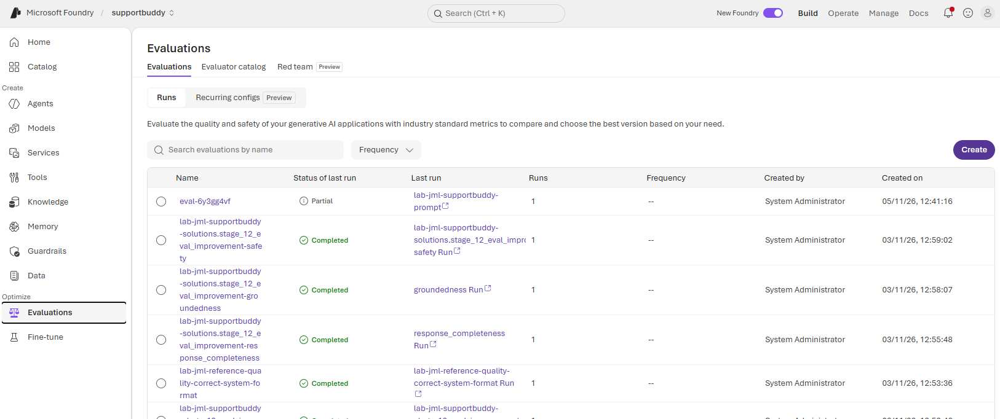

The list contains earlier runs, including a **Partial** run. Their presence is not proof that your
new baseline succeeded; inspect your own run after submission.

### 2. Select the agent and version

Under **Target**, choose **Agent**, not **Model** or **Dataset**. Select the instructor's prepared
toolbox-only prompt agent, or your allocated sandbox agent, and the agreed version. Record the
version and agent model before continuing.

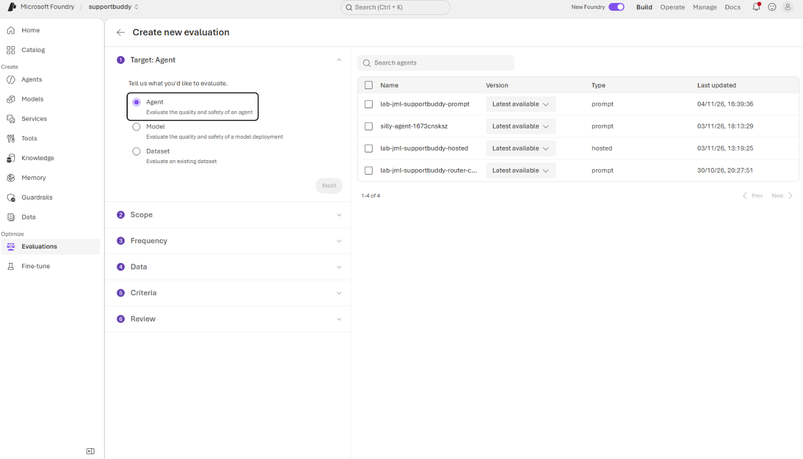

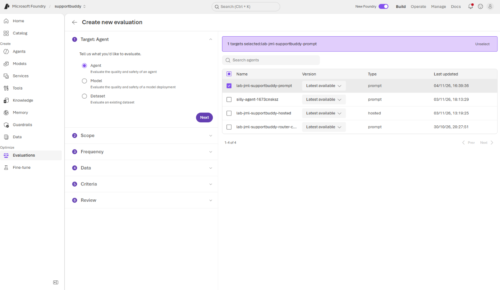

The screenshot shows **Latest available**. Select an explicit version where offered, or record
which published version that label resolves to and avoid publishing while the baseline runs.
The agent name alone does not establish that it is the toolbox-only version: verify its tools.

### 3. Choose Individual turns

Under **Scope**, select **Individual turns**, then **Next**. Each dataset query is evaluated as
a separate turn; this exercise does not simulate full conversations.

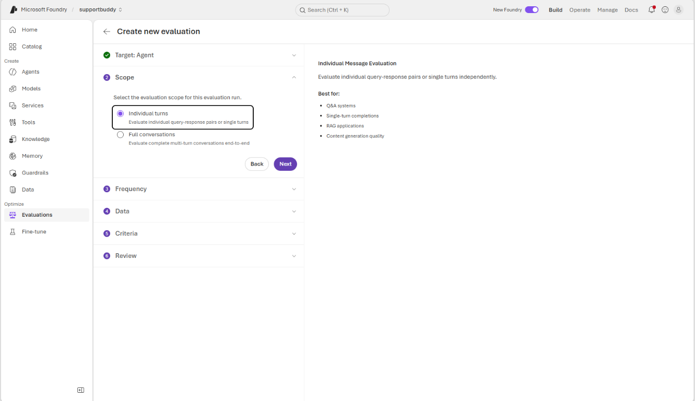

#### Trainer demonstration: evaluate full conversation history

**The trainer prefers full-conversation evaluation for assessing conversational behavior and will
demonstrate it as well.** It uses the recorded conversation, including earlier requests, replies and
available tool context, rather than assessing an isolated query-response pair. This can reveal how
the agent handles follow-up questions and uses information established earlier in the exchange.

For that separate demonstration, choose **Agent > Full conversations**, then the existing-conversation
history option where available. Select the agreed recorded conversations and time range. If history
must be supplied as a conversation dataset instead, use the supported conversation schema and field
mapping; the three-row `portal_quality.jsonl` file is not a full conversation-history dataset. Local
contact-centre chats are not automatically available in the portal unless recorded or imported through
the appropriate integration. Use only authorized synthetic lab conversations.

**Expect potentially different scores, not necessarily higher scores.** The evaluation unit, context
and supported criteria differ from the individual-turn exercise. Use conversation-compatible criteria
offered by the portal, and record the conversation selection, agent version, judge and evaluator
settings. Do not compare the two aggregate percentages as if they were the same benchmark or call
their difference an improvement by itself. Complete the individual-turn baseline below first, then
follow the trainer's conversation-history demonstration as a separate experiment.

### 4. Choose One time

Under **Frequency**, select **One time**, then **Next**. Do not enable recurring evaluations for
this classroom exercise: they would schedule additional runs and Azure usage.

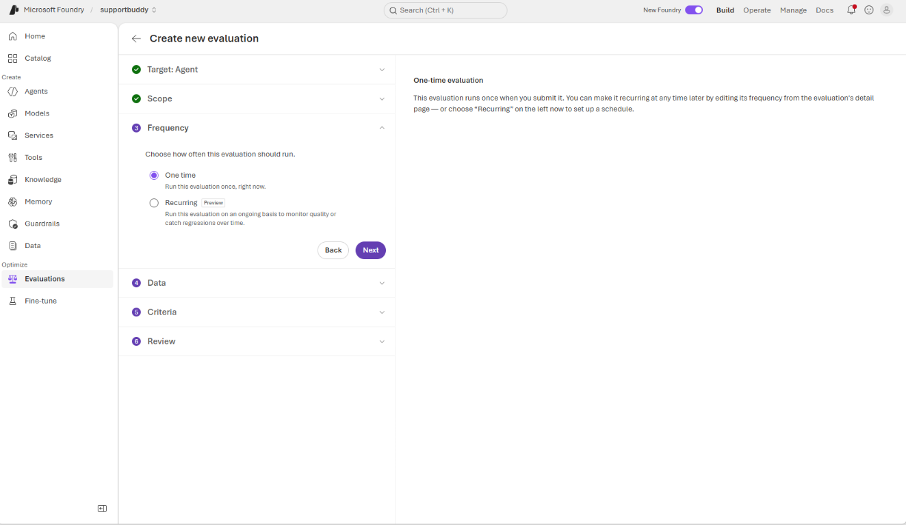

### 5. Upload or select the lab dataset

Under **Data**, select **Existing dataset**, not **Synthetic generation**, **Benchmarks** or
**Existing traces**. If the instructor already uploaded the shared dataset, select that version
and skip uploading another copy.

For the instructor's initial upload, or an explicitly assigned personal upload:

1. Select **Upload new dataset** and choose [portal_quality.jsonl](../src/evals/portal_quality.jsonl).
2. Enter a dataset name, such as `portal_quality` for the shared instructor upload, or your alias-prefixed
   name for a personal upload. A chosen file alone does not enable upload; the name is required.
3. Select **Upload** and wait for confirmation.

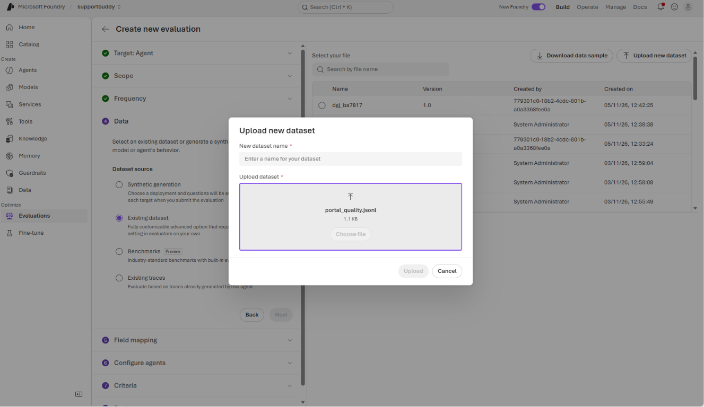

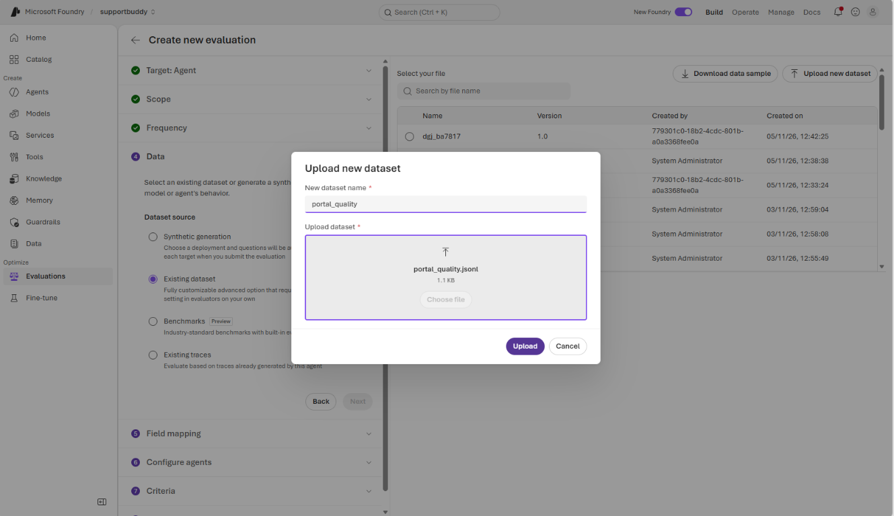

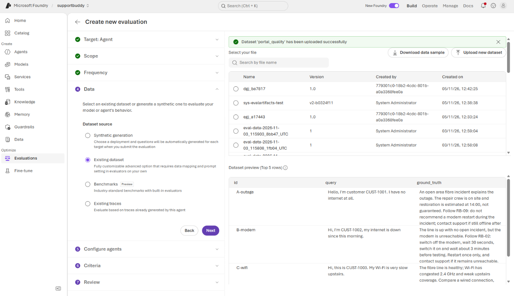

Select the uploaded dataset/version in the table. Confirm the preview has **three rows**:
`A-outage`, `B-modem` and `C-wifi`, with `id`, `query` and `ground_truth` columns. Then select **Next**.

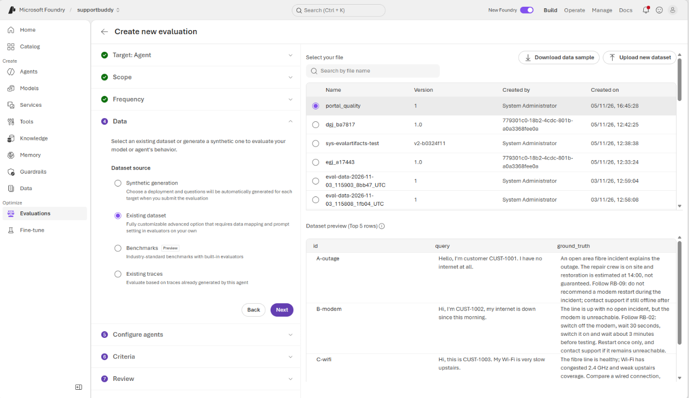

If **Field mapping** appears, map `query` to the input and `ground_truth` to the reference answer
where an evaluator requires it. Response fields must use the generated agent output. Do not map
the reference as the generated response or as retrieved grounding evidence, and resolve unassigned
required fields before submission. The screenshots do not show every possible mapping screen.

### 6. Check the agent input prompt

Under **Configure agents**, select **Configure** on the agreed agent card.

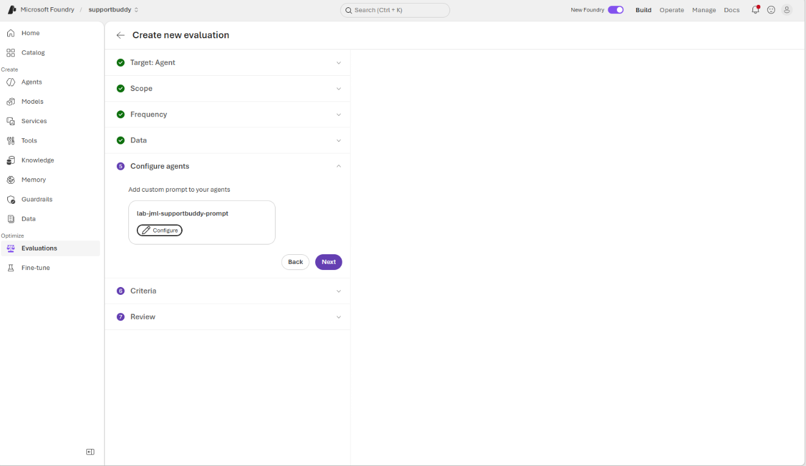

The **Add custom prompt** dialog should send the dataset query as the **USER** message:

```text
{{item.query}}
```

Keep the published agent instructions for the baseline. Do not replace them with a different system
prompt or add the reference answer to the user message. Select **Save**, then **Next**.

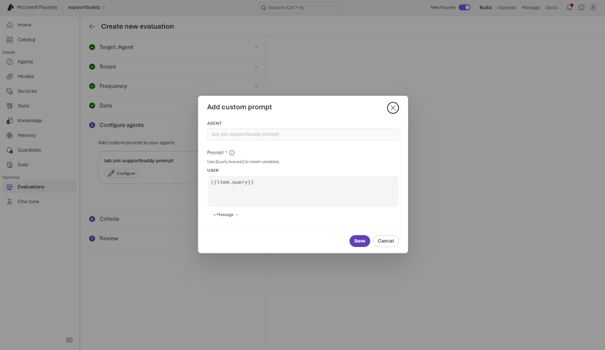

This template passes each row's query to the agent. It is not a custom evaluator or a custom judge rubric.

### 7. Select built-in criteria and the judge

Under **Criteria**, choose the instructor's agreed **Judge model** deployment independently of
the agent being tested. The captures use an earlier `supportbuddy-chat` alias; use the supported
judge named in your handout, such as `supportbuddy-judge`, rather than copying that alias.

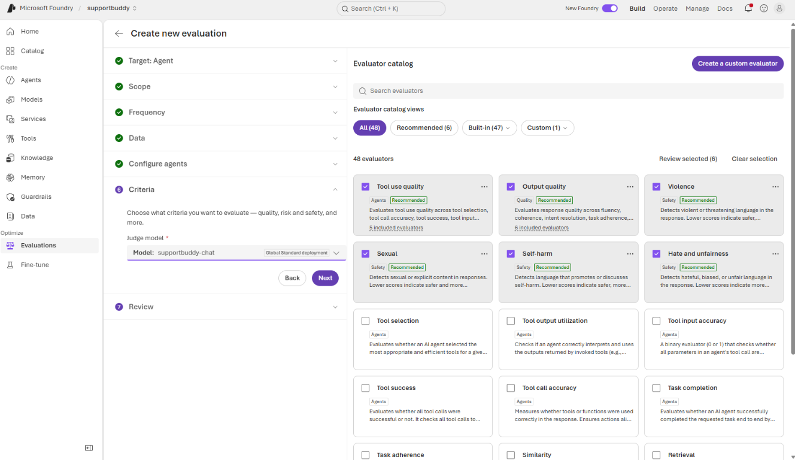

For the minimal guided route, use **Task adherence** and **Intent resolution**. Review the current
selection before submitting: the portal can preselect recommended bundles. The screenshots show
a broader example that also selects **Tool use quality**, **Output quality** and the four harmful-content
categories. Those are built-in choices, not a requirement to create custom scoring logic.

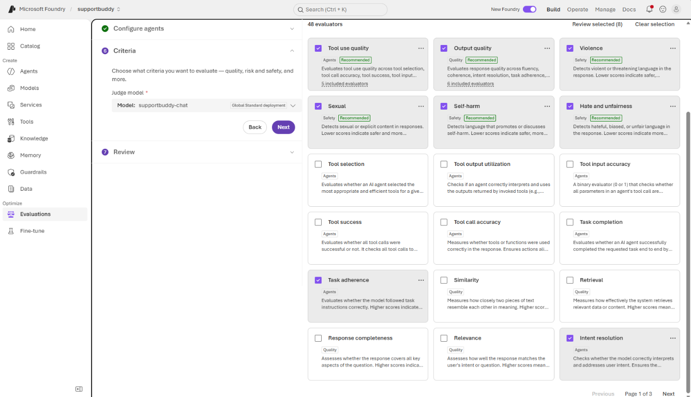

If the instructor chooses that broader set, everyone uses it for both baseline and candidate.
Review each bundle's included evaluators: selected cards are not necessarily the same count as
individual metrics. Additional judges increase usage and may require extra mapped inputs.
Use groundedness only when actual retrieved/tool evidence is available and correctly mapped;
missing evidence is not a pass. Harmful-content scoring on three quality cases is not a jailbreak
or customer-authorization test. Select **Next** when the criteria and mappings are agreed.

### 8. Review and submit the baseline

Under **Review**, enter an alias-prefixed name such as `eval-<alias>-portal-baseline`. Check the
target agent/version, **Individual turns**, **One time**, dataset/version, judge and actual selected
evaluators. Select **Edit** beside a section if something differs from the agreed experiment.

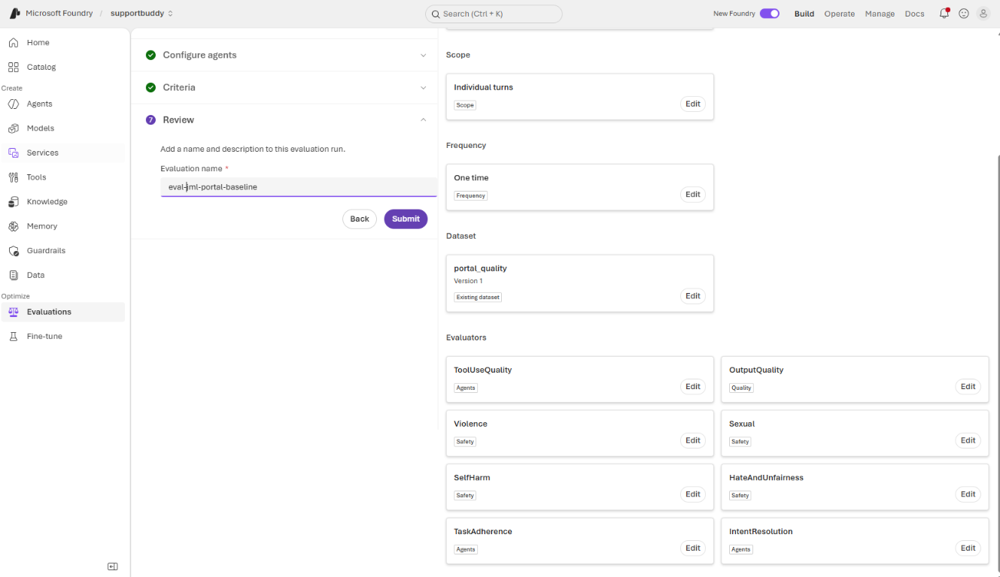

Select **Submit** only after review. This screenshot is the configuration **before submission**,
not evidence that the evaluation completed. Wait for **Completed**; **Partial**, **Failed** or missing
scores are not passes. Open your run's report and inspect each actual response and evaluator reasoning,
not only aggregate scores. Record the run link and any missing or failed metrics.

#### Wait for the submitted run

After submission, the evaluation group opens with its run listed under **Evaluation runs**.
The group name, such as `eval-jml-portal-baseline`, can differ from the run name, which here uses
the agent's name. **In progress** and a dash under **Overall score** mean results are not ready;
do not submit another copy merely because the score has not appeared yet.

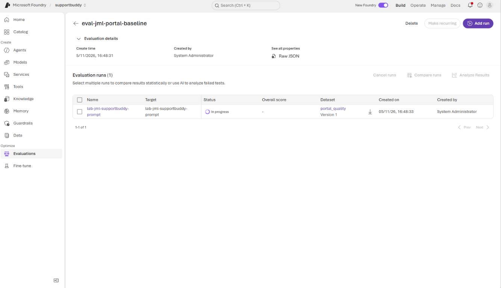

When the run finishes, **Completed** means execution and scoring completed, **not that every
evaluation check passed**. This capture shows an actual completed baseline with mixed results:

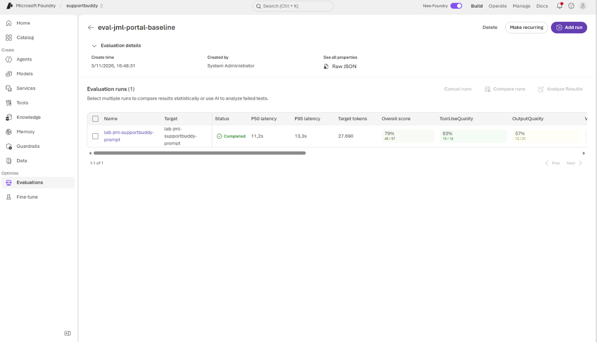

| Visible result in this example | What to record |
| --- | --- |
| Overall score **79% (45/57)** | The portal's aggregate for this run's chosen criteria, not "79% of customer cases are correct." |
| Tool-use quality **83% (15/18)** | Inspect which tool-related checks failed; do not infer every tool call was appropriate or successful. |
| Output quality **57% (12/21)** | Open the individual responses and judge reasoning to find a concrete weakness before editing instructions. |
| P50 / P95 latency **11.2 s / 13.3 s** | Observed latency for this small run, not a production performance guarantee. |
| Target tokens **27,690** | Target-model usage shown by the portal; this is not the full bill or a count of judge tokens. |

The dataset still has **three cases**. Bundles and multiple criteria create more scored outcomes
than input rows; use the detailed report to interpret the denominators. These figures are an example,
not expected scores or acceptance thresholds for every participant.

The trainer's full-conversation-history demonstration can produce a different score because it
assesses the complete recorded exchange rather than these individual turns. Label and retain that
report separately; its aggregate is not directly interchangeable with this dataset baseline.

Select the run link in the **Name** column to inspect per-case outputs, evaluator scores, reasoning
and any missing/error results. Scroll the table horizontally to see criteria not visible in the capture.
Record the actual configuration and at least one failing check with its supporting response. Keep
the baseline run unchanged, and do not enable **Make recurring** for this one-time lab exercise.

### 9. Change one instruction and compare

Together, choose one observable weakness. In your allocated sandbox agent, change one instruction
sentence, preserving the scenario clock and safety boundaries, and save a new version. If everyone
uses one shared demo agent, only the instructor edits it; participants record both versions.

Repeat the wizard with the **same dataset version, agent model, tools, judge, criteria, mappings and
input template**, changing only the intended instruction/version. Keep **One time** and name the run
with your alias and `portal-candidate`. Compare per-case responses and scores; do not assume the
candidate improved. Retain the change only when the observed comparison supports it.

## Checkpoint

Record both agent versions and evaluation links, explain one row's score with evidence from its
response, and say whether the instruction change helped or regressed a case. Three portal quality
cases are **not** the nine-case local regression, a handover/approval test, or the fixed-response
safety calibration. Keep any unresolved safety concern for Stage 13.

For the trainer's conversation-history demonstration, also record the selected scope and explain
why its score can differ from the individual-turn score. Mark it **observed** if you watched the
demonstration rather than independently running it.

## Optional: compare model deployments

After the agent exercise, the instructor can demonstrate **Model** as a separate evaluation target.
Choose one deployed candidate model at a time and keep the same input dataset, explicit system
prompt, reference context, evaluator versions, mappings and judge. Record the deployment/model
versions, responses and scores for each run. These are **base-model** results, not evaluations of
the stored SupportBuddy agent with its tools. Do not assume the tool-grounded references in the
three-case lab file make a fair bare-model benchmark: supply the required evidence consistently
or prepare a separate model-only dataset. Do not mix agent and model scores into one comparison.

If the wizard, evaluator or permissions are unavailable, follow the instructor's report review and
label it **observed, not independently run**, or switch to Route B. Never silently substitute a
base-model evaluation for the agent evaluation. See the current
[portal evaluation procedure](https://learn.microsoft.com/azure/foundry/how-to/evaluate-generative-ai-app)
for UI changes and required permissions.