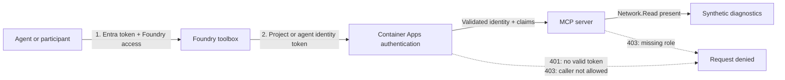

# Instructor Demo: Securing the Network MCP Server

Open the [interactive identity flow and test evidence](secure-mcp-demo.html) in a browser for the visual walkthrough.

**Status: live-tested, experimental.** Pattern A and Pattern B were exercised in Azure. During the
Pattern B test, toolbox version 6 used the hosted-agent identity, Container Apps auth was on,
and the server required `Network.Read`. A hosted conversation succeeded with request-correlated
access/tool logs. A controlled mismatch (`Network.Write` required) produced a server-side 403 with
no tool event; this verifies the role gate. It does not prove immediate role revocation, because a
revoked managed-identity role can remain in a cached token for up to 24 hours. Do not use this lab as
a production security boundary.

This is an instructor-controlled demonstration on synthetic data. It changes a shared endpoint and
can interrupt all participants. Use an isolated environment, obtain approval, and record the original
image, authentication settings, connection and toolbox default before changing anything. A test
environment must have the updated MCP server image deployed; editing the local code does not update Azure.

## The Two Identity Hops



The first token authenticates the caller to Foundry. The project connection selects the identity for
the second hop. Container Apps checks the token and its allowed-client list; only then can the server
inspect the forwarded `Network.Read` claim. A client allow-list and an app role are **separate gates**.
The role middleware relies on trusted platform-supplied identity headers; never expose it without
properly configured platform authentication. Local header tests do not establish that trust boundary.

For Pattern B the hosted agent connects to the **toolbox endpoint**, not directly to the network MCP
URL. The toolbox's network entry selects `supportbuddy-network-mcp-agent`, whose
`AgenticIdentityToken` connection authenticates the downstream MCP request. The instructor's
`grant-agent` action prepares that connection; the toolbox must explicitly select it. Changing a
project connection alone does not change an already published toolbox version.

| Pattern | Toolbox-to-server identity | Purpose | Evidence so far |
| --- | --- | --- | --- |
| A | Project managed identity | Shared project access | Anonymous `401`; toolbox listed four network tools. |
| B | Hosted agent identity | Per-agent access plus `Network.Read` | Live conversation, correlated tool logs, and a server-side 403 role-gate control verified on 8 November 2026. |
| C | User on-behalf-of | User-specific permissions | Discussion only; not implemented or tested here. |

## Instructor Walkthrough

**Before the session:** confirm the target subscription, tenant, project and Container App with the
environment owner. Use synthetic data only. Do not change the standard shared environment during a
workshop: use an agreed sandbox and a maintenance window. The instructor needs permission to manage
the Container App and project connections, plus permission to manage the relevant Entra application
and app-role assignments. Azure operations and model calls may incur charges.

1. **Show the baseline.** With the sandbox instructor environment configured, run from `instructor/`:

   ```powershell
   uv run --project ../src python secure_mcp.py status
   ```

   Record the actual auth state, connection type, allowed clients, role holders and anonymous status.
   Our earlier lab baseline was `auth off`, connection `None`, anonymous `200`. That result means the
   synthetic endpoint was publicly callable; it is not a secure production configuration.
2. **Explain Pattern A.** The instructor may run the following only after recording the original
   settings and obtaining permission for the shared-resource change:

   ```powershell
   uv run --project ../src python secure_mcp.py enable
   uv run --project ../src python secure_mcp.py status
   ```

   Expected evidence is `auth on`, connection `ProjectManagedIdentity`, and anonymous `401`. From
   `src/`, `uv run python toolbox.py show` should list the network tools. Compare with the observed
   Pattern A evidence below. A successful `show` proves discovery, not execution of a diagnostic call.
3. **Run Pattern B.** The project and hosted agent have distinct identities. Both are allowed by
   Container Apps, while the updated server separately checks `Network.Read`. From `instructor/`,
   deploy only the MCP service when its source or image changes, then configure the role and agent:

   ```powershell
   $env:AZURE_DEV_USER_AGENT = 'microsoft_foundry_skill'
   azd env select post
   azd deploy network-mcp --no-prompt
   & ..\src\.venv2\Scripts\python.exe secure_mcp.py enable --roles
   & ..\src\.venv2\Scripts\python.exe secure_mcp.py grant-agent --principal-id 46bc0229-3804-423f-b334-c657e6990e51
   ```

   From `src/`, publish the route and inspect the active connection:

   ```powershell
   & .venv2\Scripts\python.exe toolbox.py create --network-connection supportbuddy-network-mcp-agent
   & .venv2\Scripts\python.exe toolbox.py show
   ```

   `create` promotes a new version for every client of the toolbox. Record the previous default
   first. If that version has a guardrail, pass its verified `--guardrail` ID; this environment's
   version 3 had no guardrail. Local `show` prints the route and auth type, but cannot list tools for
   an `AgenticIdentityToken` connection without hosted-agent context. Verify tools by invoking the
   hosted agent, not a laptop client. For a fresh agent endpoint, use `azd ai agent show` and pass its
   Responses endpoint to `azd ai agent invoke`.

   For a cache-independent deny control, temporarily require an unassigned role, invoke the hosted
   agent, inspect the 403, then restore `Network.Read`:

   ```powershell
   & ..\src\.venv2\Scripts\python.exe secure_mcp.py set-server-role --required-role Network.Write
   # Run the same hosted-agent prompt; expect the server to deny the call.
   & ..\src\.venv2\Scripts\python.exe secure_mcp.py set-server-role --required-role Network.Read
   ```

4. **Restore the workshop baseline before continuing other labs.** With the environment owner's
   approval, return the synthetic endpoint to its original unauthenticated lab configuration.
   From `instructor/`, remove Container Apps authentication and the server role requirement, then
   check the shared connection:

   ```powershell
   uv run --project ../src python secure_mcp.py disable
   uv run --project ../src python secure_mcp.py status
   ```

   Expect `Container Apps authentication: off`, `Toolbox connection auth: None`, and anonymous
   endpoint status `200`. This open endpoint is for synthetic workshop data only, not production.

   **Also restore the toolbox route.** `disable` resets `supportbuddy-network-mcp`, but does not
   change a published toolbox version that still selects `supportbuddy-network-mcp-agent`.
   From `src/`, publish the original connection as the default and verify discovery:

   ```powershell
   uv run python toolbox.py create --network-connection supportbuddy-network-mcp
   uv run python toolbox.py show
   ```

   If the recorded baseline had a guardrail, include `--guardrail <original-policy-resource-id>`
   on `create` to preserve it. Repeat for each toolbox switched to the agent connection during
   the demo. Expect `Foundry connection: supportbuddy-network-mcp`, connection auth `None`, all
   four `network___` tools, and `runbooks___knowledge_base_retrieve`. The new default version
   number need not match the recorded original version.

   Restart any running local contact-centre or DevUI process, start a new conversation, and try
   the synthetic customer prompt again. Tool discovery alone does not verify diagnostic execution.
   Leaving the agent route active causes local clients to fail with `AgenticIdentityToken`
   errors requesting `AgentInstanceClientId` and `AgentBlueprintClientId`.

   The app registration, agent connection and role assignments remain after `disable`; retain or
   remove them only according to the owner's cleanup plan. Role revocation is not a substitute
   for restoring the route: cached managed-identity tokens can retain roles for up to 24 hours.

**Offline demonstration:** from `src/`, using the lab's installed Python environment, run:

```powershell
python -m pytest ../tests/test_mcp_access.py ../tests/test_mcp_server.py ../tests/test_secure_mcp.py -q
```

The focused suite currently covers server access, correlation, toolbox display and security-helper
operations. It does not replace the live Azure evidence below.

Local tests use mocked setup calls or simulated principal headers; only the live records below prove
the deployed platform and hosted-agent identity path.

## Evidence From Our Tests

These are observations from one synthetic environment, not guarantees for another tenant:

### Pattern A Live Run: 8 November 2026, 17:33 UTC

Pattern A was **left enabled at the end of this run**. The toolbox default remained version 3; no
image was deployed. Container Apps authentication was on, only the project client application was
allowed, and `supportbuddy-network-mcp` used `ProjectManagedIdentity`. Anonymous MCP initialize returned `401`.

The deployed `lab-jml-supportbuddy-hosted` answered the synthetic CUST-1003 Wi-Fi prompt successfully:
line up, no open area incident, congested 2.4 GHz, and weak client signal. Capture references:

- Conversation: `conv_0e99cb4f5f9e970700iKg0yZP6nyLZhqyqP1QC41mXKktAXuiF`.
- Trace: `39727eea933ab090f1d142ca43686d7a`.
- Response: `caresp_0e99cb4f5f9e970700dAnaObaGswXQH7fJZaDgaGuStq0Vfi96`.
- MCP logs: project object ID `b4cdabf7-3100-4869-b5cc-80b22e0522e4`, client ID
   `ca136f8a-d50b-4234-92c2-b10c5e82c4d5`, four tool-request events at 17:33:38-17:33:41 UTC.

In Azure Portal, open **rg-post > sb-logs-cm2tf3v7muvx6 > Logs** and run this participant view:

```kusto
ContainerAppConsoleLogs_CL
| where TimeGenerated between (datetime(2026-11-08T17:33:20Z) .. datetime(2026-11-08T17:34:00Z))
| where ContainerAppName_s == "supportbuddy-network-mcp"
| where Log_s contains "oid:" or Log_s contains "CallToolRequest"
| extend callerObject=extract("oid: ([^;]+)", 1, Log_s),
      callerClient=extract("appid: ([^;]+)", 1, Log_s),
      targetAudience=extract("aud: ([^;]+)", 1, Log_s)
| extend WhatHappened=iff(Log_s contains "CallToolRequest", "MCP server received a tool request", "MCP authentication observed a token"),
      WhoCalled=case(callerObject == "b4cdabf7-3100-4869-b5cc-80b22e0522e4", "Foundry project identity (Pattern A)",
            callerObject == "46bc0229-3804-423f-b334-c657e6990e51", "Hosted agent identity (Pattern B)",
            isempty(callerObject), "Identity is in a separate authentication row", "Other identity")
| project TimeGenerated, WhatHappened, WhoCalled, callerObject, callerClient, targetAudience
| order by TimeGenerated asc
```

Explain: **the hosted agent starts the conversation; the toolbox uses the project identity to call
MCP**. The conversation, configured default route, token metadata, and nearby tool events support
that demonstration. The old image does not emit the new per-request correlation logs, so these
records do not identify individual tool names/results or link each request to its caller. No
server-side `Network.Read` enforcement is claimed for this run.

The previous `SubscriptionNotFound` failures were caused by an ID transcription error (`fe7e`
instead of `fee7`), not demonstrated authentication failure. Use resource IDs returned by Azure.

### Pattern B Live Run: 8 November 2026

Pattern B was **left enabled at the end of this run**. The updated image ran on Container App
revision `supportbuddy-network-mcp--role-463bc7fe83`; the active Foundry toolbox was version `6`,
routing `network` through `supportbuddy-network-mcp-agent` with `AgenticIdentityToken`. Container
Apps auth allowed the project client and hosted-agent client; the server required `Network.Read`.
Anonymous MCP initialize returned `401`. The workshop baseline was restored on 9 November 2026:
toolbox version `7` selected `supportbuddy-network-mcp` with auth `None`, and discovery listed all
four network tools plus the runbook tool. This restoration check did not execute a diagnostic call.

The final hosted-agent conversation succeeded:

- Conversation: `conv_03393aaf52d1a9b300TFVM6FDMBNT18EwnFnHkTGR9p3vcIzqg`.
- Trace: `54bcfba7657f17dac46ea1d802ea4d21`.
- Response: `caresp_03393aaf52d1a9b300pIZ9h9W94pMaVP8TfujrdGGnswHMVYny`.
- Caller object/client: `46bc0229-3804-423f-b334-c657e6990e51`.
- At 23:08:54-23:09:02 UTC, Log Analytics showed `mcp_access outcome=allowed`,
  `required_role=Network.Read`, and `mcp_tool outcome=success` with matching request IDs. Example:
  `eb1e7b965a1d4746bc88c16f4a7ab150` → `identify_customer`; `03a64a19725842ddb165f4b9b015d7f0` →
  `check_equipment`.

The role-gate negative control temporarily changed only the server's required role to `Network.Write`;
the agent remained authenticated and platform-allowed, but had no such role. At 23:06:50 UTC the
server logged `outcome=denied status=403` for request IDs `8f8b863cf25c43859fe580e4b65d4d12` and
`05e1faea27ff47c882e896399bb74211`. Neither ID had an `mcp_tool` event. `Network.Read` was restored
immediately afterward. A separate attempt to revoke the agent role still succeeded because its
managed-identity token was cached, so that attempt is not evidence of immediate revocation.

In Azure Portal, open **rg-post > sb-logs-cm2tf3v7muvx6 > Logs**. This participant query displays
the success pairs:

```kusto
ContainerAppConsoleLogs_CL
| where TimeGenerated between (datetime(2026-11-08T23:08:45Z) .. datetime(2026-11-08T23:09:10Z))
| where ContainerAppName_s == "supportbuddy-network-mcp"
| where Log_s contains "mcp_access " or Log_s contains "mcp_tool "
| extend requestId=extract(@"request_id=([0-9a-f]+)", 1, Log_s),
   event=iff(Log_s contains "mcp_tool ", "TOOL", "ACCESS"),
   app=extract(@"app=([^ ]+)", 1, Log_s),
   objectId=extract(@"object=([^ ]+)", 1, Log_s),
   role=extract(@"required_role=([^ ]+)", 1, Log_s),
   tool=extract(@"tool=([^ ]+)", 1, Log_s),
   outcome=extract(@"outcome=([^ ]+)", 1, Log_s),
   status=extract(@"status=([^ ]+)", 1, Log_s)
| project TimeGenerated, requestId, event, app, objectId, role, tool, outcome, status
| order by TimeGenerated asc
```

For the denial, change the time window to `23:06:45Z .. 23:06:55Z`. Expect an ACCESS row with
`role=Network.Write`, `outcome=denied`, `status=403`, and no TOOL row for its request ID.

### Earlier Runs

1. **Baseline:** Container Apps auth off, project connection `None`, anonymous MCP initialize `200`.
   A fresh read-only check on 8 November 2026 at approximately 14:49 UTC returned:

   ```text
   Container Apps authentication: off
   Toolbox connection auth: None
   Network.Read holders: project identity, hosted-agent identity
   Endpoint without a token: 200
   ```

   The role-holder names are shortened here. The role assignment alone does not establish that the
   deployed server is checking it. No Azure settings changed during this status check.
2. **Pattern A:** auth on, connection `ProjectManagedIdentity`, anonymous request `401`. The existing
   toolbox listed `network___identify_customer`, `network___get_line_status`,
   `network___get_known_incidents`, `network___check_equipment`, and the runbook tool. Listing is
   tool discovery, not proof of a complete diagnostic tool call.
3. **First B test:** the hosted agent invocation failed with `403` while listing network tools.
   Container Apps middleware logged that the principal did not match allowed applications. The caller
   was the hosted-agent identity, not the project identity; the request did not reach the role check.
   Redacted platform output from that run:

   ```text
   2026-11-08T01:03:07Z MiddlewareWarning:
   Access was denied ... because this principal does not match any of the allowed applications.
   RequestCompleted: StatusCode 403, SubStatusCode 76
   ```

4. **Allow-list correction:** adding the hosted agent's client ID to the platform allow-list let the
   hosted agent answer the synthetic `CUST-1003` Wi-Fi scenario with runbook citations. This did
   **not** prove server-side role enforcement because the deployed image lacked the middleware hook.
5. **Local server checks:** the updated ASGI entry point rejects a missing principal with `401` and
   a principal without `Network.Read` with `403`; the middleware unit tests also cover an allowed
   role. These use simulated platform headers, not live Entra tokens.
6. **Historical restoration:** an earlier run restored the open lab baseline and toolbox version 3
   before Pattern B was deployed. After the later Pattern B run, the workshop baseline was restored
   again with toolbox version 7 as described above. Always inspect the live state before a demo.

## What To Show

For Pattern A, show the connection's authentication type in Foundry, the Container App's
**Authentication** settings and the anonymous `401`; then show toolbox tool discovery. Explain
that the shared project identity is not individual-agent authorization.

For the current Pattern B verification, demonstrate these against the **updated deployed image**:

| Check | Evidence needed |
| --- | --- |
| No token | MCP initialize returns `401`. |
| Authorized agent | The hosted agent completes network tool calls; correlated server logs identify the caller and `Network.Read`. |
| Role gate | Require `Network.Write` temporarily while the allowed hosted agent has `Network.Read`; expect `mcp_access outcome=denied status=403` and no matching tool event. This isolates server authorization from the platform allow-list. |
| Role revocation | Not an immediate deny control. Managed-identity tokens can cache app roles for up to 24 hours; one live revocation attempt still succeeded from a cached token. |
| Final state | Follow walkthrough step 4: disable demo authentication, publish the original `supportbuddy-network-mcp` toolbox route while preserving any baseline guardrail, verify discovery, and retry a fresh local conversation. |

Do not treat a script exit code or a convincing agent answer as proof that all security gates ran.
The managed identity token cache can delay permission changes; consult
[managed identity recommendations](https://learn.microsoft.com/entra/identity/managed-identities-azure-resources/managed-identity-best-practice-recommendations).

## Read The Azure Portal Screens

Use the attached portal screenshots in this order. They show three distinct controls: Container Apps
authenticates and restricts client applications; Microsoft Entra issues the `Network.Read`
application role; the MCP middleware enforces that role on each request.

| Screenshot | Portal location and what it shows | What it proves, and what it does not |
| --- | --- | --- |
| 1. Authentication overview | Container App `supportbuddy-network-mcp` > **Authentication**. Microsoft auth is enabled, unauthenticated requests return `401`, and the `supportbuddy-network-mcp` provider is configured. | Platform authentication is on. This alone does not prove that the correct client is allowed or that `Network.Read` is checked. |
| 2. Provider: Basics | **Authentication > Edit identity provider > Basics**. App/client ID is `27214115-176c-4aed-898c-a3624254f935`; issuer is the tenant's v1 STS URL; accepted audiences are `api://27214115-176c-4aed-898c-a3624254f935` and the bare app ID. The client application requirement is restricted to the agent and project client IDs. | A caller needs a valid token for this API and an allowed client application. These audience values identify the MCP API, not the caller. |
| 3. Identity requirement | The provider settings show **Allow requests from any identity**. | This is not anonymous access: unauthenticated requests still receive `401`, and the client-application allow-list still applies. It means the platform does not further restrict the token's subject identity at this setting. The server independently checks the `Network.Read` role. |
| 4. Expose an API | Entra app registration `supportbuddy-network-mcp` > **Expose an API**. Application ID URI is `api://27214115-176c-4aed-898c-a3624254f935`; no delegated scopes or authorized client applications are listed. | Pattern B uses an **application role**, not delegated OAuth scopes. Empty delegated-scope and preauthorized-client sections do not contradict the app-role flow. |
| 5. App roles | The same app registration > **App roles** shows `Network.Read`, enabled, with allowed member type **Applications**. | This is the role definition that can appear in the token's `roles` claim. A role definition by itself does not prove any agent was assigned it. |
| 6. Agent identity | Entra **Agents > Agent identities** > the SupportBuddy hosted-agent identity. The instance Object ID/Application ID is `46bc0229-3804-423f-b334-c657e6990e51`; its Blueprint App ID is `a522985e-25b4-450f-95f6-4282c649e647`. | This identifies the agent instance and its blueprint. **Entra roles: 0** refers to directory roles; it does not mean the agent has no app-role permissions. |
| 7. Granted permissions | On the agent identity, open **Access > Permissions**. It lists `supportbuddy-network-mcp`, claim `Network.Read`, type **Application**, grant source **Directly granted**. | This is the instance's app-role assignment to the MCP API. It is not Azure RBAC on the Container App or resource group; the live `mcp_access` log proves the server received and enforced the role. |

**Narration:** “The first screen shows the front door. The client ID allow-list decides which applications may present a token, while the audience says which API the token is for. The API registration defines `Network.Read`; the agent identity's Permissions page shows that the role was granted. Finally, the request-correlated server logs prove the role was present and accepted, or show the server's 403 when it was not.”

## Participant Pattern Walkthrough

Use the **Participant walkthrough** selector in the HTML page to present the same four questions for
each pattern: what is configured in Azure, what the participant asks, what must appear in logs, and
what constitutes a pass. `python toolbox.py show` confirms the default version, MCP URL, connection
and auth type. For an agent-identity route it cannot enumerate tools from a local caller; the hosted
conversation and correlated MCP logs prove actual tool discovery and execution.

Use this synthetic conversation prompt for A and B:

```text
I'm CUST-1003. My Wi-Fi drops often. Diagnose the issue using the network tools and summarize the findings.
```

| Pattern | Portal setup to show | Conversation | Log evidence and pass condition |
| --- | --- | --- | --- |
| A: project identity | Foundry project connection `supportbuddy-network-mcp` uses `ProjectManagedIdentity`; active toolbox routes `network` to that connection. Container App auth and project-identity allow-list are configured. | Run the deployed hosted agent with the prompt above. The hosted agent is the caller to Foundry; the MCP server should see the project identity. | `mcp_access` identifies the project identity with `outcome=allowed`; `mcp_tool` has the same `request_id`, named tool, and `outcome=success`. This proves shared project access, not per-agent identity. |
| B: hosted-agent identity | Connection `supportbuddy-network-mcp-agent` uses `AgenticIdentityToken`; toolbox v6 routes `network` to it. Container App allows the hosted agent and requires `Network.Read`. | Run the deployed hosted agent, not a local participant client, with the same prompt. | Live `mcp_access` and `mcp_tool` rows share request IDs and identify the agent. For the deny control, temporarily require `Network.Write`; expect `403` and no matching tool row, then restore `Network.Read`. |
| C: user on-behalf-of | No OBO connection or delegated token flow exists in this project. | No supported conversation test. Do not treat a participant's laptop token as a toolbox OBO call. | Not testable. Implement user sign-in, delegated scopes, token exchange and caller logging before presenting this as a runnable pattern. |

Start each conversation fresh and use the same prompt for A and B. The chat answer alone is not
evidence: show the toolbox route in Foundry, then the correlated server records. For the Azure log
query and field meanings, see [Show The Agent Identity](#show-the-agent-identity).

## Show The Agent Identity

The current hosted-agent identity and audience are shown in the Pattern B live-run record above.
These identifiers belong to this test environment; check the active agent, connection, and audience
again in another environment or after republishing.

The identity and route come from separate records:

| Source | Record/field to inspect | Observed value |
| --- | --- | --- |
| Foundry hosted agent | `agents.get(...).instance_identity.principal_id` and `.client_id` | Both `46bc0229-3804-423f-b334-c657e6990e51` |
| Container Apps authentication log | `oid` and `appid` in token metadata | Both match the Foundry identity above; `aud` is `api://27214115-176c-4aed-898c-a3624254f935` |
| Foundry Toolbox version 6 | `tools[]` entry with `server_label: network` | `server_url` is `https://supportbuddy-network-mcp.jollystone-c8960a3d.swedencentral.azurecontainerapps.io/mcp`; connection is `supportbuddy-network-mcp-agent` |
| Foundry project connection | `credentials.type` and `target` | `AgenticIdentityToken`; same Container Apps `/mcp` URL |
| Container Apps console log | `Processing request of type CallToolRequest` | Four MCP tool-request events between 11:04:36 and 11:04:39 UTC |

The current live request-to-tool correlation is shown below and in the Pattern B live-run record.
The earlier token metadata and `CallToolRequest` rows were separate historical evidence and did not
prove which toolbox version served each call.

The current version of this query shows request-level caller and tool correlation:

```kusto
ContainerAppConsoleLogs_CL
| where TimeGenerated between (datetime(2026-11-08T23:08:45Z) .. datetime(2026-11-08T23:09:10Z))
| where ContainerAppName_s == "supportbuddy-network-mcp"
| where Log_s contains "mcp_access " or Log_s contains "mcp_tool "
| extend requestId=extract(@"request_id=([0-9a-f]+)", 1, Log_s),
   event=iff(Log_s contains "mcp_tool ", "TOOL", "ACCESS"),
   app=extract(@"app=([^ ]+)", 1, Log_s),
   objectId=extract(@"object=([^ ]+)", 1, Log_s),
   role=extract(@"required_role=([^ ]+)", 1, Log_s),
   tool=extract(@"tool=([^ ]+)", 1, Log_s),
   outcome=extract(@"outcome=([^ ]+)", 1, Log_s),
   status=extract(@"status=([^ ]+)", 1, Log_s)
| project TimeGenerated, requestId, event, app, objectId, role, tool, outcome, status
| order by TimeGenerated asc
```

In each successful request, the ACCESS and TOOL rows share the same `requestId`; the ACCESS row shows
the hosted-agent IDs and `Network.Read` decision. The query contains no tokens, raw headers, tool
arguments, or results.

### Correlated Logs (Live)

The updated MCP server generates an `X-Request-ID` for each HTTP request. Its `mcp_access` log
records the authenticated caller and role decision; when a tool handler runs, its `mcp_tool` log
records the same request ID, tool name, and success or error outcome. No tool arguments, results,
tokens, or raw principal headers are logged. A role denial has an access record with `status=403`
and no tool-execution record.

For the role-denial control, change the time range to
`datetime(2026-11-08T23:06:45Z) .. datetime(2026-11-08T23:06:55Z)`. Expect ACCESS rows with
`role=Network.Write`, `outcome=denied`, and `status=403`, and no TOOL row for those request IDs.

```kusto
ContainerAppConsoleLogs_CL
| where TimeGenerated > ago(1h)
| where ContainerAppName_s == "supportbuddy-network-mcp"
| where Log_s contains "mcp_access " or Log_s contains "mcp_tool "
| extend requestId=extract(@"request_id=([0-9a-f]+)", 1, Log_s),
   event=iff(Log_s contains "mcp_tool ", "TOOL EXECUTION", "ACCESS CHECK"),
   app=extract(@"app=([^ ]+)", 1, Log_s),
   objectId=extract(@"object=([^ ]+)", 1, Log_s),
   role=extract(@"(?:required_role|role)=([^ ]+)", 1, Log_s),
   tool=extract(@"tool=([^ ]+)", 1, Log_s),
   outcome=extract(@"outcome=([^ ]+)", 1, Log_s),
   status=extract(@"status=([^ ]+)", 1, Log_s)
| project TimeGenerated, requestId, event, app, objectId, role, tool, outcome, status
| order by TimeGenerated desc
```

For a successful call, find an `ACCESS CHECK` row with `outcome=allowed` and a `TOOL EXECUTION`
row with the **same `requestId`**, caller IDs, tool name, and `outcome=success`. For the negative
control, show an `ACCESS CHECK` row with the test caller, `outcome=denied`, and `status=403`; there
should be no `TOOL EXECUTION` row with that ID. A local integration test exercises this correlation
through the actual MCP HTTP app with a simulated principal. Live Azure proof still requires deploying
this image and directing the hosted agent to the toolbox version that uses its agent identity.

## Find The Logs

In Azure Portal, open the Container App's **Log stream**, or its Log Analytics workspace **Logs**.
For the observed B2 failure, this query targets the authorization middleware rather than model output:

```kusto
ContainerAppConsoleLogs_CL
| where TimeGenerated between (datetime(2026-11-08T01:03:00Z) .. datetime(2026-11-08T01:03:15Z))
| where ContainerAppName_s == "supportbuddy-network-mcp"
| where Log_s contains "MiddlewareWarning" or Log_s contains "RequestCompleted"
| project TimeGenerated, Log_s
| order by TimeGenerated asc
```

The observed warning said the principal did not match any allowed applications, followed by `403`
and substatus `76`. An empty allow-list blocked the request in this environment; adding the intended
agent client ID allowed the request through. This is different from the application's own
`refused: ... lacks role Network.Read` log. Avoid sharing raw tokens, principal headers, or sensitive logs.

## Practical Boundaries

The helper at [secure_mcp.py](secure_mcp.py) and server middleware are experimental until the live
checks above pass. `status` reads current configuration and probes the endpoint; `enable`,
`grant-agent`, `revoke-agent`, and `disable` change Azure. `disable` restores the lab's **open**
default, not arbitrary pre-existing security settings, and does not remove the app registration,
roles, assignments, agent connection, or toolbox versions. Do not run it against an environment
whose original configuration is not the lab default. Reprovisioning or rerunning the setup hook can
overwrite the connection or server settings; recheck them before any demonstration.
